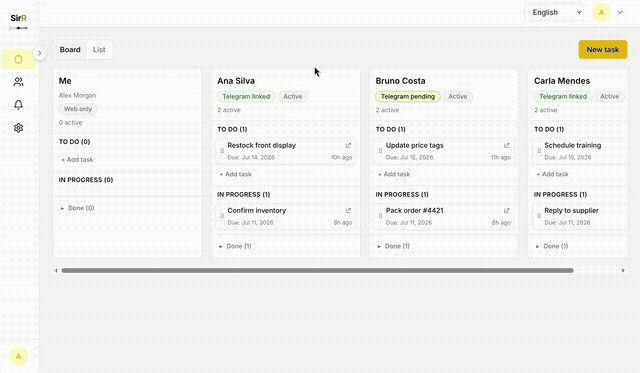

# SRelay

Tasks, due dates, and clarity for you or your team — with AI that helps create the tasks, no KPI dashboards or productivity theater.

**App:** [app.sirrelay.com](https://app.sirrelay.com) · **Demo:** [app.sirrelay.com/en-gb/demo](https://app.sirrelay.com/en-gb/demo)

[](https://open-vsx.org/extension/sirrelay/sirrelay)
[](https://www.npmjs.com/package/@sirrelay/mcp)



## What it does

- **Board or list** — see what’s open, in progress, and done
- **Ask AI** — turn a short note into concrete tasks with suggested due dates and assignees; accept, edit, or discard each one
- **Groups** — work alone or invite others; same task truth for everyone
- **IDE + MCP** — your column in the editor ([Open VSX extension](https://open-vsx.org/extension/sirrelay/sirrelay)) or agent tools via [`@sirrelay/mcp`](https://www.npmjs.com/package/@sirrelay/mcp)

Locales: `en-gb` · `es-es` · `pt-br`

| | |
|---|---|
| Brand / app / repo | **Sir** · **SRelay** · mark **SR** · `sir-relay` · `sirrelay.com` |
| Clients | [VSIX](./extensions/vsix/) · [MCP](./extensions/mcp/) · [Cursor plugin](./extensions/cursor-plugin/) · [Teams](./extensions/teams/) |

**Roles (per group):** Operator manages members/tasks on the web. Teammate works on the web for their own tasks. Details: [docs/REQUIREMENTS.md](./docs/REQUIREMENTS.md).

---

## Docs (read before changing code)

| File | Use for |
|------|---------|
| [**ARCHITECTURE.md**](./docs/ARCHITECTURE.md) | Where code lives · services · mock → API |
| [**REQUIREMENTS.md**](./docs/REQUIREMENTS.md) | Product rules, IDs, API, permissions |
| [**UIUX.md**](./docs/UIUX.md) | Layout, boards, screens (UI work) |
| [**ENVIRONMENTS.md**](./docs/ENVIRONMENTS.md) | Dev mock · prod local · how to run |
| [**BRAND.md**](./docs/BRAND.md) | Colors, logos, tokens (UI work) |

Ops / publish (only when needed): [DEPLOY-DIGITALOCEAN.md](./docs/DEPLOY-DIGITALOCEAN.md) · [extensions/mcp/PUBLISH.md](./extensions/mcp/PUBLISH.md) · [PRODUCT.md](./PRODUCT.md) (landing / Impeccable).

---

## Run locally

```bash
npm install && npm run dev-mock && npm run check:routes
```

Open `http://localhost:3000` · demo `sam@example.com` / `ana@example.com` (any password in mock).

| Environment | Command |
|-------------|---------|
| Dev mock | `npm run dev-mock` |
| Prod local (Docker stack) | `npm run prod-local` |
| Prod VPS | `bash scripts/env/prod-vps.sh` |

Stack: Next.js 16 · React 19 · Prisma · PostgreSQL · grammy · Docker Compose + Caddy — [REQUIREMENTS §10](./docs/REQUIREMENTS.md#10-tech-stack--repo-layout).

```bash
npm run audit:prod   # npm audit --omit=dev (P2-SEC-10)
```

---

## License

SRelay is [FSL-1.1-MIT](./LICENSE) (**source-available**, not open source / OSI). Copyright 2026 Andre Aleixo.

You may use, modify, and share it for any purpose except a Competing Use: offering SRelay, or something with the same function, as a commercial product or service to others. Internal use is allowed. Two years after a version is published, that version is available under the MIT license. See [NOTICE](./NOTICE) for third-party material.

Contributions are accepted under the same terms.

## Security

Report vulnerabilities to contact@sirrelay.com. Do not open a public issue for a security report.
