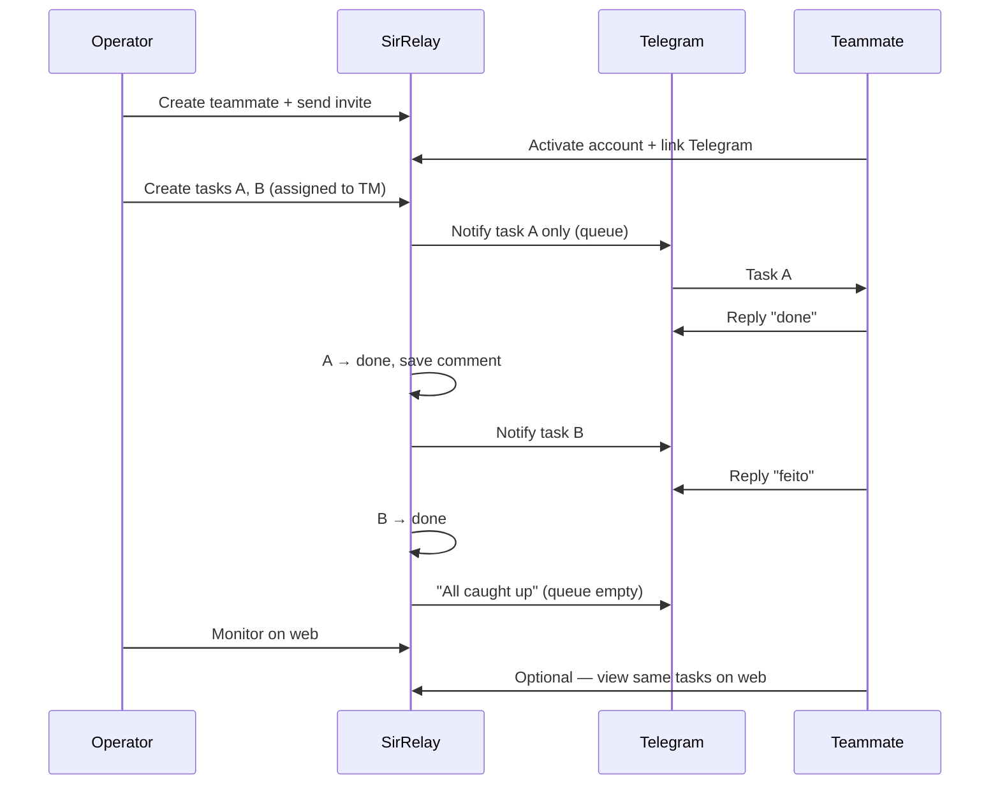

# SirRelay — Requirements

**Product:** SirRelay · **Brand:** Sir  
**Status:** Living spec — 3 phases, implement one at a time  
**Audience:** Developer / AI implementer  
**Last updated:** 2026-06-27

Related docs: [BRAND.md](./BRAND.md) (visual identity) · [UIUX.md](./UIUX.md) (layouts & interaction) · [README.md](./README.md) (overview)

---

## 1. Product summary

**SirRelay** is a self-hosted task relay for teams of **2–5 teammates**, built by **Sir**.

| Piece | Description |
|-------|-------------|
| **Web app** | Single app, two roles: **Operator** (manages everything) and **Teammate** (own tasks only) |
| **Telegram bot** | Delivers tasks one at a time; teammates reply to report progress |
| **Relay queue** | When a task is marked `done`, the next `todo` task is sent automatically |

**Operator** creates teammates and tasks, monitors all activity on the web.

**Teammate** works via Telegram (primary) or web (optional): sees assigned tasks, updates status, adds comments.

**Languages:** English, Spanish, Portuguese (`en`, `es`, `pt`).

---

## 2. Core workflow



**Relay queue rules:**

1. Each teammate receives **at most one** active Telegram notification (`todo` or `doing`).
2. On task **create**: notify only if the teammate’s queue is empty (no other `todo`/`doing` task).
3. On task **`done`**: send the next `todo` (order: `due_date ASC`, then `created_at ASC`).
4. If no tasks remain: send a short “all caught up” message.

---

## 3. Development phases

| Phase | Goal | Done when |
|-------|------|-----------|
| **1** | Workflow + deploy | Relay loop works; both roles on web; VPS + HTTPS |
| **2** | Security + audit + ops | Hardened app; audit log; VPS runbook in README |
| **3** | Enhancements | Backlog items, one at a time |

Implement **one phase at a time**. Do not skip ahead unless explicitly requested.

---

## 4. Locked decisions

| Topic | Decision |
|-------|----------|
| Brand / app / repo | **Sir** · **SirRelay** · `sir-relay` |
| Telegram bot name | **SirRelay** (e.g. `@SirRelayBot`) |
| Web app | Single Next.js app; UI and API scoped by `role` |
| Roles | **Operator** — full access · **Teammate** — own tasks only |
| Operator accounts | One seeded on deploy (Phase 1); multiple → Phase 3 |
| Teammate signup | Invite-only; no public registration |
| Task assignee | One teammate per task |
| Task statuses | `todo` · `doing` · `done` |
| Relay | One Telegram notification per teammate at a time (§2) |
| Hosting | **DigitalOcean Droplet** (EU region) · Docker Compose · PostgreSQL · Caddy (HTTPS) |
| Stack | Next.js App Router · TypeScript · Prisma · grammy · next-intl · Tailwind · Zod |
| Visual identity | [BRAND.md](./BRAND.md) |
| **Product model** | **A — Single-tenant self-host** (§4.1). One install = one organization. No public signup. Umbrel/VPS/Docker. Multi-tenant SaaS out of scope unless explicitly requested. |

### 4.1 Product model A (single-tenant self-host)

| Aspect | Decision |
|--------|----------|
| Deployment | One instance per organization (Docker on DO, Umbrel, private VPS) |
| Entry URL | `/[locale]/admin` — sign-in + administration (GitLab-style instance portal) |
| Users | Invite-only; Operator manages users in **Admin → Users** |
| Public registration | **No** — no “create account” on a shared cloud |
| Scaling | Vertical (bigger VPS) or **multiple Operators** (P3-02) within same instance; many customers = many instances, not one multi-tenant DB |
| Future SaaS (model B) | Not Phase 1–3 unless product direction changes |

---

## 5. Phase 1 — Core workflow & deploy

### 5.1 Authentication

| ID | Requirement | Acceptance criteria |
|----|-------------|---------------------|
| P1-AUTH-01 | Login | Email + password; invalid credentials → generic 401; JWT includes `role` |
| P1-AUTH-02 | Logout | Clears session |
| P1-AUTH-03 | Session expiry | Default 7 days; override via `SESSION_MAX_AGE_DAYS` |
| P1-AUTH-04 | Bootstrap Operator | On empty DB, seed one `operator` from `ADMIN_EMAIL` + `ADMIN_PASSWORD` |
| P1-AUTH-05 | First-login password change | Seeded Operator must change password before using the app |
| P1-AUTH-06 | Password storage | bcrypt; minimum 8 characters |
| P1-AUTH-07 | Change password | Available on **Profile** (both roles); forced first login via `/change-password` |
| P1-AUTH-08 | Update profile | `PATCH /me` — update `locale` (`en` \| `es` \| `pt`); optional avatar in later phase |
| P1-AUTH-09 | Teammate signup | Operator creates teammate → invite link (72h) → `/join/<token>` → set password |
| P1-AUTH-10 | Post-login routing | `operator` → all tasks · `teammate` → my tasks |

### 5.2 Teammates

Operator-only management.

| ID | Requirement | Acceptance criteria |
|----|-------------|---------------------|
| P1-TM-01 | Create | Display name + email required |
| P1-TM-02 | List | Name, email, account (`invited` / `active`), Telegram (`linked` / `pending`), active flag |
| P1-TM-03 | Deactivate | `active: false`; excluded from assignee picker; cannot log in; existing tasks unchanged |
| P1-TM-04 | Edit | Rename; change email (only before first login) |
| P1-TM-05 | Invite | One-time token (72h); activates account on password set |
| P1-TM-06 | Regenerate invite | New token if expired and account not yet active |
| P1-TM-07 | Link Telegram | One-time code (72h); `t.me/<bot>?start=<code>` or `/start <code>` |
| P1-TM-08 | Regenerate Telegram link | New code if expired |
| P1-TM-09 | One chat per teammate | `telegram_chat_id` unique across users |

### 5.3 Tasks & relay queue

| ID | Requirement | Acceptance criteria |
|----|-------------|---------------------|
| P1-TASK-01 | Create | Operator only; title + assignee (active teammate); optional description, due_date |
| P1-TASK-02 | Notify on create | Send Telegram if assignee is linked **and** queue is empty (§2) |
| P1-TASK-03 | Re-notify | Operator only; resend Telegram; update `telegram_message_id` (replies bind to latest message) |
| P1-TASK-04 | List / Kanban | Operator: all non-archived · Teammate: assigned to me; 3 status columns |
| P1-TASK-05 | Update / archive | Operator: any field · Teammate: status + comment on own tasks only |
| P1-TASK-06 | Detail | Task + comments + Telegram delivery status; Teammate only if assignee |
| P1-TASK-07 | Due date | Optional `DATE`; overdue when `due_date` < today UTC |
| P1-TASK-08 | Limits | Title ≤ 200 · description ≤ 10 000 |
| P1-TASK-09 | Reply threading | Store `telegram_message_id` + `telegram_chat_id` on each notify; replies must reference latest message |
| P1-TASK-10 | Status sync | Telegram keyword or web update persists immediately for both roles |
| P1-TASK-11 | Queue order | Next task: `todo`, non-archived, `due_date ASC NULLS LAST`, `created_at ASC` |
| P1-TASK-12 | Auto-dispatch | On `done` (Telegram keyword or Teammate web): notify next task per P1-TASK-11; if none, send queue-empty message (P1-TG-08) |

### 5.4 Comments

| ID | Requirement | Acceptance criteria |
|----|-------------|---------------------|
| P1-CMT-01 | Web | Operator: any task · Teammate: own tasks |
| P1-CMT-02 | Telegram | Reply → comment (`source: telegram`); may update status (P1-TG-04) |
| P1-CMT-03 | Display | Chronological; badge for Web / Telegram + author |
| P1-CMT-04 | Limits | Body ≤ 2 000 characters |

### 5.5 UI & i18n

| ID | Requirement | Acceptance criteria |
|----|-------------|---------------------|
| P1-UI-01 | Branding | Login/header logos per [BRAND.md](./BRAND.md); favicon `icon.svg`; tokens `brand/brand.css` |
| P1-UI-02 | Role-based nav | Operator: Teammates + all tasks · Teammate: My tasks + settings; **Profile** via avatar / sidebar footer (not primary nav) |
| P1-VIEW-01 | List sort | By due date, status, updated_at |
| P1-VIEW-02 | Task boards | Teammate: 3-column Kanban (To do · In progress · Done). Operator: one column per teammate — To do + In progress expanded, Done collapsed — [UIUX.md §3](./UIUX.md#3-task-boards--two-layouts) |
| P1-VIEW-03 | List view | Both roles; sort/filter; mobile fallback for Operator board |
| P1-VIEW-04 | Responsive | Usable at 375px; Operator board → list on mobile per UIUX.md |
| P1-I18N-01 | Locales | Full UI in `en`, `es`, `pt` via next-intl |
| P1-I18N-02 | User locale | Persisted; selector on login, header, and settings (`PATCH /me`) |
| P1-I18N-03 | Telegram copy | Per-teammate locale; fallback `en` |

### 5.6 Telegram bot

| ID | Requirement | Acceptance criteria |
|----|-------------|---------------------|
| P1-TG-01 | Webhook | `POST /api/v1/telegram/webhook` |
| P1-TG-02 | Task message | Title, description (truncated to 500 chars + `…`), due date, reply instruction |
| P1-TG-03 | Reply → comment | Reply to latest notification creates comment |
| P1-TG-04 | Status keywords | Case-insensitive match on reply: **→ `done`:** `done`, `hecho`, `concluída`, `feito`, `listo` · **→ `doing`:** `in progress`, `em progresso`, `en progreso`, `working` · Persist comment + status in one transaction; `done` triggers P1-TASK-12 |
| P1-TG-05 | Authorization | Ignore unlinked chats; ignore replies to tasks not assigned to sender |
| P1-TG-06 | `/start <code>` | Links Telegram chat; send welcome confirmation |
| P1-TG-07 | Delivery warnings | Task always saves; web warns if Telegram pending or API failed |
| P1-TG-08 | Queue empty | Localized short message when no next `todo` (e.g. “All caught up — no more tasks.”) |

### 5.7 Security (minimum to ship)

Full hardening → Phase 2.

| ID | Requirement |
|----|-------------|
| P1-SEC-01 | HTTPS in production (Caddy TLS) |
| P1-SEC-02 | Secrets in env; ship `.env.example`; no secrets in git |
| P1-SEC-03 | Authenticate all `/api/v1/*` except login, join, health, webhook; enforce role + ownership (§8) |
| P1-SEC-04 | JWT in httpOnly cookie; `Secure` in production |
| P1-SEC-05 | Prisma parameterized queries; React escapes output |
| P1-SEC-06 | Invite and Telegram link tokens: store hash only; single-use; 72h expiry |
| P1-SEC-07 | Verify `X-Telegram-Bot-Api-Secret-Token` on webhook |

### 5.8 Deploy

| ID | Requirement |
|----|-------------|
| P1-DEP-01 | `docker-compose.yml`: app, postgres, Caddy |
| P1-DEP-02 | `docker compose up -d` starts the stack |
| P1-DEP-03 | Postgres persistent volume |
| P1-DEP-04 | README: env setup, first login, Telegram webhook registration |
| P1-DEP-05 | Next.js `output: 'standalone'` |
| P1-DEP-06 | `GET /api/v1/health` → `{ "status": "ok" \| "fail" }` (`fail` = DB unreachable) |
| P1-DEP-07 | Versioned Prisma migrations |

**Environment variables:**

| Variable | Required | Notes |
|----------|----------|-------|
| `APP_URL` | Yes | Public URL for links and webhook |
| `DATABASE_URL` | Yes | PostgreSQL connection string |
| `SESSION_SECRET` | Yes | JWT signing key |
| `SESSION_MAX_AGE_DAYS` | No | Default `7` |
| `ADMIN_EMAIL` | Yes | Seeds Operator on first deploy |
| `ADMIN_PASSWORD` | Yes | Seeds Operator on first deploy |
| `TELEGRAM_BOT_TOKEN` | Yes | From BotFather |
| `TELEGRAM_WEBHOOK_SECRET` | Yes | Webhook verification |

### 5.9 Data model

```
users
  id, name, email, password_hash, role (operator|teammate), locale,
  telegram_chat_id, active, must_change_password, created_at, updated_at

teammate_invite_tokens
  id, user_id, token_hash, expires_at, used_at, created_at

telegram_link_tokens
  id, user_id, token_hash, expires_at, used_at, created_at

tasks
  id, title, description, assignee_id, created_by_id,
  status (todo|doing|done), due_date, archived,
  telegram_message_id, telegram_chat_id, telegram_notified_at,
  created_at, updated_at

comments
  id, task_id, body, source (web|telegram), author_user_id, created_at
```

- `assignee_id` → `users.id` where `role = teammate`
- `created_by_id` → `users.id` where `role = operator`

### 5.10 Routes

**Web** (`/[locale]/`):

| Route | Operator | Teammate | Notes |
|-------|----------|----------|-------|
| `admin` | Sign-in / redirect | Sign-in / redirect | **Default landing** when not in app |
| `login` | Redirect → `admin` | Redirect → `admin` | Legacy alias |
| `join/[token]`, `change-password` | ✓ | ✓ | |
| `profile` | ✓ | ✓ |
| `tasks` | All tasks | My tasks |
| `tasks/new`, `tasks/[id]/edit` | ✓ | — |
| `tasks/[id]` | ✓ | Own tasks only |
| `teammates`, `teammates/new`, `teammates/[id]` | ✓ (list includes operators) | — |
| `settings` | ✓ | ✓ |

**API:** see §9.

**Phase 1 acceptance test:** Operator creates teammate → invite + Telegram link → creates two tasks → only first notified → teammate replies `done` → second arrives on Telegram → both visible on web → stack runs on VPS with HTTPS.

---

## 6. Phase 2 — Security, audit & operations

### 6.1 Application security

| ID | Requirement | Acceptance criteria |
|----|-------------|---------------------|
| P2-SEC-01 | IDOR protection | Every resource route validates role + ownership |
| P2-SEC-02 | Session revocation | `token_version` on user; increment on password change; invalidate on logout |
| P2-SEC-03 | Account lockout | 5 failed logins per email per 15 min → lock 15 min |
| P2-SEC-04 | Password policy | Min 8 + uppercase + number; block common passwords |
| P2-SEC-05 | Security headers | HSTS, `X-Frame-Options: DENY`, `X-Content-Type-Options: nosniff`, `Referrer-Policy`, CSP |
| P2-SEC-06 | CSRF | Protection on cookie-auth mutations |
| P2-SEC-07 | Rate limits | Login 10/min/IP · API 100/min/IP (authenticated) |
| P2-SEC-08 | Login errors | Generic message; no email enumeration |
| P2-SEC-09 | Telegram input | Sanitize; strip control characters |
| P2-SEC-10 | Dependency audit | Document `npm audit` in README; fix critical/high before deploy |
| P2-SEC-11 | Safe logging | Never log passwords, tokens, or full comment bodies; JSON logs |

### 6.2 Audit log

| ID | Requirement | Acceptance criteria |
|----|-------------|---------------------|
| P2-AUD-01 | Events | Login, logout, password change, invite, Telegram link, task CRUD, notify, reply, status change, relay dispatch |
| P2-AUD-02 | Storage | `audit_logs`: id, action, actor_type, actor_id, metadata, created_at |
| P2-AUD-03 | UI | `/[locale]/audit` — paginated, read-only (Operator) |
| P2-AUD-04 | API | `GET /api/v1/audit` |

**Schema addition:**

```
users.token_version   INT DEFAULT 0

audit_logs
  actor_type: operator | teammate | system
```

### 6.3 VPS operations (document in README)

| ID | Requirement |
|----|-------------|
| P2-OPS-01 | Firewall: ports 22 (SSH restricted), 80, 443 |
| P2-OPS-02 | Postgres not public; Docker internal network |
| P2-OPS-03 | SSH key-only |
| P2-OPS-04 | Daily `pg_dump`; store backups off VPS |
| P2-OPS-05 | Documented restore procedure (test once) |
| P2-OPS-06 | Containers run as non-root |
| P2-OPS-07 | `.env` file mode `600` |
| P2-OPS-08 | `SESSION_SECRET` ≥ 32 random bytes |
| P2-OPS-09 | Monthly OS and image updates |

### 6.4 Monitoring & analytics

**Two layers** — do not conflate them:

| Layer | Answers | Tooling | Cookie consent |
|-------|---------|---------|----------------|
| **Audit log** (P2-AUD) | Who did what? (login, task CRUD, invite, relay) | `audit_logs` table + `/audit` UI | No — server-side, essential for security |
| **Access / ops** | Is the app up? Who hit the server? | Caddy access logs, `GET /health`, JSON app logs | No — infrastructure |
| **Web analytics** (optional) | Which screens are used? Mobile vs desktop? | Self-hosted **Umami** or **Plausible** (recommended) | **Yes** — unless provider is cookieless and legal review confirms exemption |

**Locked decision:** No Google Analytics or third-party SaaS that sends data outside the VPS. Analytics, if enabled, runs **self-hosted** on the same deployment (subdomain e.g. `analytics.<APP_URL>` or path proxy).

| ID | Requirement | Acceptance criteria |
|----|-------------|---------------------|
| P2-MON-01 | Structured app logs | JSON logs: request id, user id (if session), route, status; never log passwords or tokens |
| P2-MON-02 | Failed login visibility | Audit event + optional Operator alert threshold (Phase 3) |
| P2-ANA-01 | Self-hosted analytics (optional) | Umami or Plausible in Docker Compose; disabled by default |
| P2-ANA-02 | Env toggle | `ANALYTICS_ENABLED=false` default; `ANALYTICS_SCRIPT_URL` when true |
| P2-ANA-03 | Cookie consent | If analytics uses non-essential cookies: banner on first visit — **Necessary** (session) always on · **Analytics** opt-in; store preference in `localStorage` or cookie `sirrelay_consent` |
| P2-ANA-04 | Privacy policy | `/privacy` links cookies used, analytics (if on), retention, self-hosted controller |
| P2-ANA-05 | Load script only after consent | No analytics network calls until user accepts (or cookieless mode documented) |

**Phase 1 minimum (before analytics):** session cookie + login notice + privacy page stub. **Phase 2:** audit log covers operational monitoring; enable analytics when product usage insights are needed.

**Environment variables (when analytics enabled):**

| Variable | Required | Notes |
|----------|----------|-------|
| `ANALYTICS_ENABLED` | No | Default `false` |
| `ANALYTICS_SCRIPT_URL` | If enabled | e.g. `https://analytics.example.com/script.js` |
| `ANALYTICS_SITE_ID` | If enabled | Provider site id |

---

## 7. Phase 3 — Backlog

| ID | Feature |
|----|---------|
| P3-01 | Operator Telegram alerts on teammate reply |
| P3-02 | Multiple Operator accounts |
| P3-03 | Drag-and-drop Kanban |
| P3-04 | Comment edit/delete (Operator) |
| P3-05 | Due date reminders (Telegram, 24h before) |
| P3-06 | Daily digest to Operator Telegram |
| P3-07 | Offline web sync |
| P3-08 | Slack integration |
| P3-09 | 2FA / TOTP for Operator |
| P3-10 | Custom branding overrides |
| P3-11 | Export tasks (CSV/JSON) |
| P3-12 | Encrypted backups (GPG) |
| P3-13 | Logo collapse animation ([BRAND.md](./BRAND.md) §3.3) |

### 7.1 Offline web sync (P3-07)

Both roles. Requires Phase 1 API + DB. Out of scope: PWA install, Service Worker, multi-tab coordination.

| ID | Requirement | Acceptance criteria |
|----|-------------|---------------------|
| P3-OFF-01 | Session task state | Web edits update UI immediately in memory; full page load fetches server; unsent changes lost on refresh |
| P3-OFF-02 | Mutation queue | In-memory pending writes `{ clientMutationId, type, taskId, payload, baseUpdatedAt }`; MVP types: `update_status`, `reassign` (Operator); permissions per §8 |
| P3-OFF-03 | Sync attempt | On each mutation, call API first; enqueue only on failure (network, timeout, 5xx) |
| P3-OFF-04 | No revert on failure | Failed sync keeps session UI + queue until success or conflict resolution; refresh loads server |
| P3-OFF-05 | Sync bar | Top bar when queue non-empty after retry threshold; `en` / `es` / `pt`; states: syncing, failed, conflict; hidden when synced |
| P3-OFF-06 | Sync now | Replays queue against §9 routes; partial failure lists failed items; full success clears banner |
| P3-OFF-07 | Auto-retry | Optional: retry queue on browser `online` event |
| P3-OFF-08 | Idempotent writes | `PATCH /tasks/:id` accepts optional `clientMutationId`; duplicate replay → 200, no double write |
| P3-OFF-09 | Conflicts | `PATCH /tasks/:id` accepts optional `baseUpdatedAt`; server newer → `409` + task snapshot; user picks keep local or use server |
| P3-OFF-10 | Relay | P1-TASK-12 runs only after server persist; offline delay acceptable |

---

## 8. Permissions

| Action | Operator | Teammate (web) | Teammate (Telegram) |
|--------|----------|----------------|---------------------|
| Log in | ✓ | ✓ (invite) | — |
| Manage teammates | ✓ | — | — |
| Create / edit / archive tasks | ✓ | — | — |
| View tasks | All | Assigned to me | Current notification |
| Change status | ✓ | Own tasks (`done` → relay) | Keywords (`done` → relay) |
| Comment | Any task | Own tasks | Reply |
| Re-notify | ✓ | — | — |
| Link Telegram | Generate code | Via `/start` code | `/start <code>` |
| Audit log | ✓ (Phase 2) | — | — |

---

## 9. API contract

Base path: `/api/v1` · Error format: `{ "error": "code", "message": "string" }`

| Method | Path | Phase | Auth |
|--------|------|-------|------|
| POST | `/auth/login` | 1 | Public |
| POST | `/auth/join` | 1 | Public `{ token, password }` |
| POST | `/auth/logout` | 1 | Session |
| POST | `/auth/change-password` | 1 | Session |
| GET | `/me` | 1 | Session |
| PATCH | `/me` | 1 | Session `{ locale }` |
| GET | `/teammates` | 1 | Operator |
| POST | `/teammates` | 1 | Operator |
| PATCH | `/teammates/:id` | 1 | Operator |
| POST | `/teammates/:id/invite` | 1 | Operator |
| POST | `/teammates/:id/telegram-link` | 1 | Operator |
| GET | `/tasks` | 1 | Operator (all) · Teammate (mine) |
| POST | `/tasks` | 1 | Operator |
| GET | `/tasks/:id` | 1 | Operator · Teammate (if assignee) |
| PATCH | `/tasks/:id` | 1 | Operator (full) · Teammate (status, if assignee) |
| POST | `/tasks/:id/notify` | 1 | Operator |
| POST | `/tasks/:id/comments` | 1 | Operator · Teammate (if assignee) |
| GET | `/tasks/:id/comments` | 1 | Operator · Teammate (if assignee) |
| POST | `/telegram/webhook` | 1 | Webhook secret |
| GET | `/health` | 1 | Public |
| GET | `/audit` | 2 | Operator |
| POST | `/sync` | 3 | Session — optional batch replay (P3-OFF-06) |

---

## 10. Tech stack & repo layout

| Layer | Choice |
|-------|--------|
| Framework | Next.js 14+ App Router · React · TypeScript (strict) |
| ORM | Prisma |
| i18n | next-intl |
| Auth | jose (JWT) + httpOnly cookie |
| Telegram | grammy |
| Validation | Zod |
| Styling | Tailwind CSS |
| Proxy | Caddy |

```
/
├── README.md
├── REQUIREMENTS.md
├── BRAND.md
├── brand/
├── public/
├── docker-compose.yml
├── Dockerfile
├── prisma/
└── src/
    ├── app/[locale]/
    ├── app/api/v1/
    ├── lib/
    ├── messages/
    └── middleware.ts
```

**Repo status:** UI mock phase + deploy skeleton (Dockerfile, Compose, Caddy). Phase 1 API/Prisma pending.

---

## 11. Glossary

| Term | Meaning |
|------|---------|
| Operator | Full-access web role; UI: Operator / Operador |
| Teammate | Limited web role + Telegram; UI: Teammate / Compañero / Colega |
| Relay queue | One active Telegram task per teammate; next sent on `done` |
| Task status | Code: `todo` · `doing` · `done`. UI (en): To do · In progress · Done — see [UIUX.md](./UIUX.md#status-naming) |
| Account status | `invited` (no password yet) · `active` (can log in) |
| Telegram status | `linked` · `pending` |
| Phase | Delivery milestone — not a version number |

---

## 12. Implementation notes (AI)

1. Read the target phase — implement **only that phase**.
2. Phase 1 before Phase 2 or 3.
3. Phase 2 extends Phase 1 (migrations for `audit_logs`, `token_version`).
4. Phase 3: one backlog item at a time unless told otherwise.

**Example prompt:** *Implement Phase 1 per REQUIREMENTS.md. Do not implement Phase 2 or 3.*

---

## Revision history

| Date | Change |
|------|--------|
| 2026-06-25 | Initial spec; 3-phase structure; Sir brand |
| 2026-06-27 | Operator + Teammate roles; relay queue; unified `users` model; spec cleanup; [UIUX.md](./UIUX.md); P3-07 offline web sync (§7.1) |
