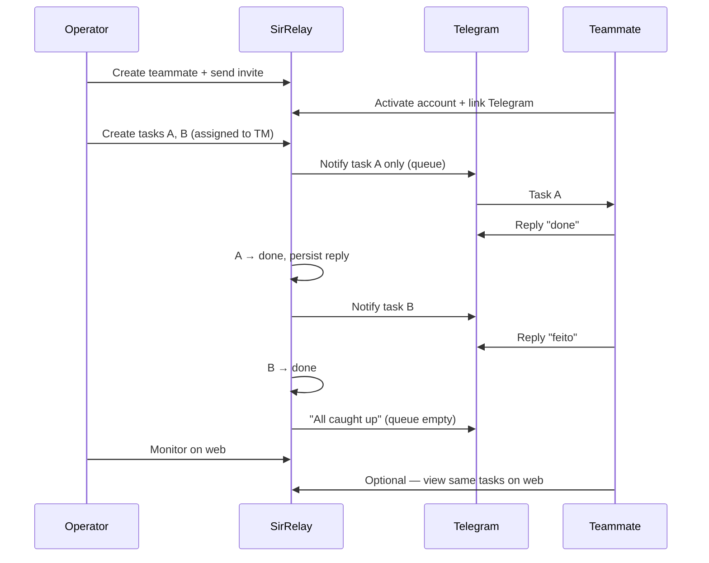

# SirRelay — Requirements

**Product:** SirRelay · **Brand:** Sir  
**Status:** Living spec — 3 phases, implement one at a time  
**Audience:** Developer / AI implementer  
**Last updated:** 2026-07-11

Related docs: [BRAND.md](./BRAND.md) · [UIUX.md](./UIUX.md) · [README.md](../README.md) · [DEPLOY-DIGITALOCEAN.md](./DEPLOY-DIGITALOCEAN.md)

---

## 1. Product summary

**SirRelay** is a **hosted web task relay** for small teams (typically **2–5 people per group**), built by **Sir**. Deployed on a **public domain** (DigitalOcean + HTTPS); data lives in **PostgreSQL** on the server.

| Piece | Description |
|-------|-------------|
| **Marketing site** | Public landing at `/[locale]` — product story, demo, Sign up / Log in |
| **Web app** | One account per person; work happens inside a **group**. **Role** (`operator` / `teammate`) is **per group**, not a global account type |
| **Telegram bot** | Delivers tasks one at a time; teammates reply to report progress |
| **Relay queue** | When a task is marked `done`, the next `todo` task is sent automatically |

**Account model:** Anyone can **sign up**. After login they **create a group** (becoming **operator** there) or **join a group** via invite (as **teammate**). The **same user** can be operator in one group and teammate in another — switch active group via the **header group switcher panel** or `/groups` when no group is active.

**Positioning:** Simple team coordination — **no performance dashboards, leaderboards, or surveillance-style metrics.**

**Operator (in a group)** creates teammates and tasks (including self-assigned tasks), monitors activity on the web.

**Teammate (in a group)** works via Telegram (primary) or web (optional): sees assigned tasks and updates status on the web. Telegram replies are stored server-side for relay; there is **no web comment thread**.

**Clients:** Responsive **web first** (Phase 1). Native **iOS/Android** → Phase 3 (P3-13), same `/api/v1`.

**Languages:** English, Spanish, Portuguese (`en`, `es`, `pt`).

---

## 2. Core workflow



**Relay queue rules:**

1. Each teammate receives **at most one** active Telegram notification (`todo` or `doing`).
2. On task **create**: notify only if the teammate’s queue is empty (no other `todo`/`doing` task).
3. On task **`done`**: send the next `todo` (order: `due_date ASC`, then `created_at ASC`).
4. If no tasks remain: send a short “all caught up” message.

**Relay applies to teammates only.** Tasks assigned to an Operator (self) are web-only — no Telegram queue or dispatch.

---

## 3. Development phases

| Phase | Goal | Done when |
|-------|------|-----------|
| **1** | Workflow + deploy | Relay loop works; both roles on web; VPS + HTTPS |
| **2** | Security + audit + ops | Hardened app; audit log; VPS runbook in README |
| **3** | Enhancements | Backlog items, one at a time |

Implement **one phase at a time**. Do not skip ahead unless explicitly requested.

---

## 4. Locked decisions

| Topic | Decision |
|-------|----------|
| Brand / app / repo | **Sir** · **SirRelay** · `sir-relay` |
| Telegram bot name | **SirRelay** (e.g. `@SirRelayBot`) |
| Web app | Single Next.js app; permissions scoped by **active group** + **membership role** |
| Roles | **Operator** — full access in that group · **Teammate** — own tasks only in that group |
| Bootstrap (deploy) | On empty DB, seed one **user** from `ADMIN_EMAIL` + `ADMIN_PASSWORD` (may create first group manually) |
| Joining a group | **Create group** → creator is operator · **Invite link** → join as teammate (account may already exist from sign-up) |
| Task assignee | One user per task — **active teammate** or **operator (self)** in the same group |
| Relay scope | Telegram relay queue applies **only** to tasks assigned to linked teammates |
| Operator alerts | Optional Telegram on Profile; notify on teammate **task done** and **due/overdue** (§5.6) |
| Task statuses | `todo` · `doing` · `done` |
| Relay | One Telegram notification per teammate at a time (§2) |
| Hosting | **DigitalOcean Droplet** (EU region) · Docker Compose · PostgreSQL · Caddy (HTTPS) |
| Stack | Next.js App Router · TypeScript · Prisma · grammy · next-intl · Tailwind · Zod |
| Visual identity | [BRAND.md](./BRAND.md) |
| **Product model** | **Hosted web app** (§4.1). Public landing + sign-in app on one domain. PostgreSQL persistence. |

### 4.1 Product model — Hosted web app (primary)

| Aspect | Decision |
|--------|----------|
| **Deployment** | One SirRelay stack on **DigitalOcean Droplet** (EU), public **domain + HTTPS** (Caddy). Same Docker Compose can run elsewhere if needed. |
| **Public entry** | `/[locale]` — marketing landing (logged-out visitors) |
| **Sign up / Log in** | `/[locale]/signup` · `/[locale]/login` — any user creates an account |
| **No active group** | `/[locale]/groups` — placeholder; group panel opens automatically |
| **Legacy** | `/[locale]/admin` redirects to `/login` |
| **Data** | **PostgreSQL** on the deployment; tasks, users, groups, and settings persisted server-side |
| **Accounts (Phase 1)** | Self-serve **sign-up** (anyone). User **creates a group** (operator) **or joins** via invite link (teammate). Role is **per group membership**, not stored on the user row. |
| **Session** | `{ userId, activeGroupId }`; effective `role` derived from `group_memberships` for the active group |
| **Multi-group** | One account may belong to many groups; **group switcher panel** or `/groups` when no active group |
| **Mobile** | Responsive web in Phase 1; native iOS/Android → Phase 3 (P3-13), same `/api/v1` |
| **Metrics / KPIs** | **Out of scope** — no velocity charts, leaderboards, or employee surveillance dashboards |
| **Multi-tenant SaaS** | Not Phase 1 — one organization per deployment. Many customers = many deployments (or P3-15). |
| **Private VPS / LAN** | Same Docker stack works elsewhere; Telegram webhook still needs a **public HTTPS URL**. |

---

## 5. Phase 1 — Core workflow & deploy

### 5.1 Authentication

| ID | Requirement | Acceptance criteria |
|----|-------------|---------------------|
| P1-AUTH-01 | Login | Email + password; invalid credentials → generic 401; session stores `userId` + `activeGroupId`; **role** resolved from membership |
| P1-AUTH-02 | Logout | Clears session |
| P1-AUTH-03 | Session expiry | Default 7 days; override via `SESSION_MAX_AGE_DAYS` |
| P1-AUTH-04 | Bootstrap user | On empty DB, seed one user from `ADMIN_EMAIL` + `ADMIN_PASSWORD` |
| P1-AUTH-05 | First-login password change | **Bootstrap user only** (`must_change_password`); normal sign-ups skip forced change |
| P1-AUTH-06 | Password storage | bcrypt; minimum 8 characters |
| P1-AUTH-07 | Change password | Available on **Profile** (all users); optional forced flow via `/change-password` |
| P1-AUTH-08 | Update profile | `PATCH /me` — update `locale` (`en` \| `es` \| `pt`); optional avatar in later phase |
| P1-AUTH-09 | Group invite | Operator adds teammate to group → invite link (72h) → `/join/<token>` → set password (new account) or activate (existing) |
| P1-AUTH-10 | Post-login routing | No group → `/groups` · operator in active group → `/teammates` · teammate in active group → `/tasks` |
| P1-AUTH-11 | Sign up | `/signup` — name, email, password; new user has **no group** until create or join |
| P1-AUTH-12 | Active group | Session holds `activeGroupId`; all app data (tasks, teammates, alerts) scoped to active group |

### 5.1.1 Groups

| ID | Requirement | Acceptance criteria |
|----|-------------|---------------------|
| P1-GRP-01 | List | **Group switcher panel** lists groups with name + **role**; `/groups` is placeholder when no active group (panel opens) |
| P1-GRP-02 | Create | **Group switcher → Create group** (inline name ≥ 2 chars); creator is `operator`; group becomes active. `/groups/new` → redirect legacy |
| P1-GRP-03 | Select | **Group switcher** sets `activeGroupId` → role home |
| P1-GRP-04 | Auto-select | Single group + no active group → `GET /groups/auto` persiste cookie → role home; 2+ groups → `/groups` + panel open |
| P1-GRP-05 | Manage | **Group switcher panel** anytime — switch, create, join (no session clear) |
| P1-GRP-06 | Join via invite | Invite link → `/join/<token>` (new account) **or** paste in group panel (signed in, same email) |
| P1-GRP-07 | Join from panel | Paste invite in group panel → accept when signed in; adds membership if missing |
| P1-GRP-08 | Existing email | Operator adds teammate email that already has an account → membership added; group in switcher |

### 5.2 Teammates

Operator-only management **within the active group**.

| ID | Requirement | Acceptance criteria |
|----|-------------|---------------------|
| P1-TM-01 | Create | Display name + email required |
| P1-TM-02 | List | Name, email, account (`invited` / `active`), Telegram (`linked` / `pending`), active flag |
| P1-TM-03 | Deactivate | `active: false`; excluded from assignee picker; cannot log in; existing tasks unchanged |
| P1-TM-04 | Edit | Rename; change email (only before first login) |
| P1-TM-05 | Invite | One-time token (72h); activates account on password set |
| P1-TM-06 | Regenerate invite | New token if expired and account not yet active |
| P1-TM-07 | Link Telegram | One-time code (72h); `t.me/<bot>?start=<code>` or `/start <code>` |
| P1-TM-08 | Regenerate Telegram link | New code if expired |
| P1-TM-09 | One chat per teammate | `telegram_chat_id` unique across users |

### 5.3 Tasks & relay queue

| ID | Requirement | Acceptance criteria |
|----|-------------|---------------------|
| P1-TASK-01 | Create | Operator only; title + assignee (active teammate **or self**); optional description, due_date |
| P1-TASK-02 | Notify on create | Send Telegram if assignee is a **linked teammate** **and** queue is empty (§2); **no Telegram** for Operator self-tasks |
| P1-TASK-03 | Re-notify | Operator only; resend Telegram; update `telegram_message_id` (replies bind to latest message) |
| P1-TASK-04 | List / Kanban | Operator: all tasks · Teammate: assigned to me; 3 status columns |
| P1-TASK-05 | Update / delete | Operator: any field on any task · Teammate: edit + delete own tasks (title, status, due, description) |
| P1-TASK-06 | Detail | Editable form (shared with create layout) + Telegram delivery banner; Teammate only if assignee; **no web comment UI** |
| P1-TASK-07 | Due date | Optional `DATE`; overdue when `due_date` < today UTC |
| P1-TASK-08 | Limits | Title ≤ 200 · description ≤ 10 000 |
| P1-TASK-09 | Reply threading | Store `telegram_message_id` + `telegram_chat_id` on each notify; replies must reference latest message |
| P1-TASK-10 | Status sync | Telegram keyword or web update persists immediately for both roles |
| P1-TASK-11 | Queue order | Next task: `todo`, `due_date ASC NULLS LAST`, `created_at ASC` |
| P1-TASK-12 | Auto-dispatch | On `done` (Telegram keyword or Teammate web): notify next task per P1-TASK-11; if none, send queue-empty message (P1-TG-08). **Skip relay** when assignee is Operator. |
| P1-TASK-13 | Operator self-tasks | Operator may assign tasks to themselves; visible on web board in **Me** column and in list view; status updates on web only (no Telegram relay) |

### 5.4 Telegram activity (no web comment UI)

Web app has **no comment thread**. Telegram replies are persisted for relay/audit only.

| ID | Requirement | Acceptance criteria |
|----|-------------|---------------------|
| P1-CMT-01 | Telegram reply log | Reply to latest notification creates a server record (`source: telegram`); may update status (P1-TG-04) |
| P1-CMT-02 | Limits | Body ≤ 2 000 characters |

### 5.5 UI & i18n

| ID | Requirement | Acceptance criteria |
|----|-------------|---------------------|
| P1-UI-01 | Branding | Login/header logos per [BRAND.md](./BRAND.md); favicon `icon.svg`; tokens `brand/brand.css` |
| P1-UI-02 | Role-based nav | Nav reflects **role in active group**: Operator → Tasks · Teammates · Alerts · Settings · Teammate → Tasks · Settings; **Profile** via avatar / sidebar footer |
| P1-UI-03 | Marketing landing | Public `/[locale]` when logged out — hero, product demo, feature highlights, footer — [UIUX.md §2.0](./UIUX.md#20-marketing-landing) |
| P1-UI-04 | Landing header | `logo.svg`, locale switcher, **Sign up** + **Log in** → `/signup` · `/login` |
| P1-UI-05 | Product demo | **`public/brand/demo.webm`** in hero (muted, loop); CSS board fallback |
| P1-UI-06 | No metric UI | No velocity charts, leaderboards, or employee KPI dashboards in Phase 1–2 |
| P1-UI-07 | App store links | **None** in Phase 1 — web only; native store badges → P3-13 |
| P1-VIEW-01 | List sort | By due date, status, updated_at |
| P1-VIEW-02 | Task boards | Teammate: 3-column Kanban (To do · In progress · Done). Operator: **Me** column (self-assigned tasks) + one column per active teammate — To do + In progress expanded, Done collapsed — [UIUX.md §3](./UIUX.md#3-task-boards--two-layouts) |
| P1-VIEW-03 | List view | Both roles; sort/filter; mobile fallback for Operator board |
| P1-VIEW-04 | Responsive | Usable at 375px; Operator board → list on mobile per UIUX.md |
| P1-I18N-01 | Locales | Full UI in `en`, `es`, `pt` via next-intl |
| P1-I18N-02 | User locale | Persisted; selector on login, header, and **Profile** (`PATCH /me`) |
| P1-I18N-03 | Telegram copy | Per-teammate locale; fallback `en` |

### 5.6 Telegram bot

| ID | Requirement | Acceptance criteria |
|----|-------------|---------------------|
| P1-TG-01 | Webhook | `POST /api/v1/telegram/webhook` |
| P1-TG-02 | Task message | Title, description (truncated to 500 chars + `…`), due date, reply instruction |
| P1-TG-03 | Reply → comment | Reply to latest notification creates comment |
| P1-TG-04 | Status keywords | Case-insensitive match on reply: **→ `done`:** `done`, `hecho`, `concluída`, `feito`, `listo` · **→ `doing`:** `in progress`, `em progresso`, `en progreso`, `working` · Persist comment + status in one transaction; `done` triggers P1-TASK-12 |
| P1-TG-05 | Authorization | Ignore unlinked chats; ignore replies to tasks not assigned to sender |
| P1-TG-06 | `/start <code>` | Links Telegram chat; send welcome confirmation |
| P1-TG-07 | Delivery warnings | Task always saves; web warns if Telegram pending or API failed |
| P1-TG-08 | Queue empty | Localized short message when no next `todo` (e.g. “All caught up — no more tasks.”) |
| P1-TG-09 | Operator alert — task done | When a teammate marks a task `done` (Telegram keyword or web), send a Telegram message to **each Operator** with linked Telegram: task title, teammate name, timestamp |
| P1-TG-10 | Operator alert — due / overdue | Daily job (UTC): for each teammate task with `due_date` ≤ today and status ≠ `done`, notify linked Operators once per task per due day (dedupe); message includes title, assignee, due date, overdue flag |
| P1-TG-11 | Operator Telegram link | Optional on **Profile** (same `/start <code>` flow as teammates); used for P1-TG-09/10 only — Operators do not receive task relay queue |

### 5.7 Security (minimum to ship)

Full hardening → Phase 2.

| ID | Requirement |
|----|-------------|
| P1-SEC-01 | HTTPS in production (Caddy TLS) |
| P1-SEC-02 | Secrets in env; ship `.env.example`; no secrets in git |
| P1-SEC-03 | Authenticate all `/api/v1/*` except login, join, health, webhook; enforce role + ownership (§8) |
| P1-SEC-04 | JWT in httpOnly cookie; `Secure` in production |
| P1-SEC-05 | Prisma parameterized queries; React escapes output |
| P1-SEC-06 | Invite and Telegram link tokens: store hash only; single-use; 72h expiry |
| P1-SEC-07 | Verify `X-Telegram-Bot-Api-Secret-Token` on webhook |

### 5.8 Deploy

| ID | Requirement |
|----|-------------|
| P1-DEP-01 | `docker-compose.yml`: app, postgres, Caddy |
| P1-DEP-02 | `docker compose up -d` starts the stack |
| P1-DEP-03 | Postgres persistent volume |
| P1-DEP-04 | README + deploy doc | Env setup, DNS, first login, landing at `/`, Telegram webhook — [DEPLOY-DIGITALOCEAN.md](./DEPLOY-DIGITALOCEAN.md) |
| P1-DEP-05 | Next.js `output: 'standalone'` |
| P1-DEP-06 | `GET /api/v1/health` → `{ "status": "ok" \| "fail" }` (`fail` = DB unreachable) |
| P1-DEP-07 | Versioned Prisma migrations |

**Environment variables:**

| Variable | Required | Notes |
|----------|----------|-------|
| `APP_URL` | Yes | Public URL for links and webhook |
| `DATABASE_URL` | Yes | PostgreSQL connection string |
| `SESSION_SECRET` | Yes | JWT signing key |
| `SESSION_MAX_AGE_DAYS` | No | Default `7` |
| `ADMIN_EMAIL` | Yes | Seeds bootstrap **user** on first deploy |
| `ADMIN_PASSWORD` | Yes | Seeds bootstrap **user** on first deploy |
| `TELEGRAM_BOT_TOKEN` | Yes | From BotFather |
| `TELEGRAM_WEBHOOK_SECRET` | Yes | Webhook verification |

### 5.9 Data model

```
users
  id, name, email, password_hash, locale,
  telegram_chat_id, active, must_change_password, created_at, updated_at

groups
  id, name, created_at, updated_at

group_memberships
  group_id, user_id, role (operator|teammate), created_at
  UNIQUE (group_id, user_id)

teammate_invite_tokens
  id, user_id, token_hash, expires_at, used_at, created_at

telegram_link_tokens
  id, user_id, token_hash, expires_at, used_at, created_at

tasks
  id, group_id, title, description, assignee_id, created_by_id,
  status (todo|doing|done), due_date,
  telegram_message_id, telegram_chat_id, telegram_notified_at,
  created_at, updated_at

telegram_activity   -- optional audit log for Telegram replies (not shown on web)
  id, task_id, body, author_user_id, created_at
```

- **No `role` on `users`** — role lives on `group_memberships`
- `assignee_id` → `users.id` (teammate **or** operator in the same group)
- `created_by_id` → operator membership in that group
- All task/teammate queries filter by `session.activeGroupId`

### 5.10 Routes

**Web** (`/[locale]/`):

| Route | Operator in group | Teammate in group | Notes |
|-------|-------------------|-------------------|-------|
| `/` (locale home) | Redirect if session | Redirect if session | **Public landing** when logged out |
| `login`, `signup` | Public | Public | Account entry; **AuthPageHeader** → back to landing |
| `groups` | ✓ | ✓ | No active group landing (panel opens); create/join in switcher |
| `privacy`, `terms` | Public | Public | Footer links; **AuthPageHeader** on legal pages |
| `join/[token]`, `change-password` | — | — | Auth flows |
| `admin` | — | — | Legacy redirect → `login` |
| `profile` | ✓ | ✓ | Account is global; accessible without active group; no role badge |
| `tasks` | All tasks in group | My tasks in group |
| `tasks/new` | ✓ | — |
| `tasks/[id]` | ✓ | Own tasks only | Edit form + delete (mock) |
| `teammates`, `teammates/new`, `teammates/[id]` | ✓ (list includes operators in group) | — |
| `alerts` | ✓ | — |
| `settings` | ✓ | ✓ | Group-scoped operator alert prefs only |

**Phase 1 acceptance test:** Landing → sign up → create group → add teammate → invite + Telegram → two tasks → relay `done` on Telegram. **Or:** demo `sam@example.com` → `/groups` → Demo Shop → same loop. Stack on VPS with HTTPS.

---

## 6. Phase 2 — Security, audit & operations

### 6.1 Application security

| ID | Requirement | Acceptance criteria |
|----|-------------|---------------------|
| P2-SEC-01 | IDOR protection | Every resource route validates role + ownership |
| P2-SEC-02 | Session revocation | `token_version` on user; increment on password change; invalidate on logout |
| P2-SEC-03 | Account lockout | 5 failed logins per email per 15 min → lock 15 min |
| P2-SEC-04 | Password policy | Min 8 + uppercase + number; block common passwords |
| P2-SEC-05 | Security headers | HSTS, `X-Frame-Options: DENY`, `X-Content-Type-Options: nosniff`, `Referrer-Policy`, CSP |
| P2-SEC-06 | CSRF | Protection on cookie-auth mutations |
| P2-SEC-07 | Rate limits | Login 10/min/IP · API 100/min/IP (authenticated) |
| P2-SEC-08 | Login errors | Generic message; no email enumeration |
| P2-SEC-09 | Telegram input | Sanitize; strip control characters |
| P2-SEC-10 | Dependency audit | Document `npm audit` in README; fix critical/high before deploy |
| P2-SEC-11 | Safe logging | Never log passwords, tokens, or full comment bodies; JSON logs |

### 6.2 Audit log

| ID | Requirement | Acceptance criteria |
|----|-------------|---------------------|
| P2-AUD-01 | Events | Login, logout, password change, invite, Telegram link, task CRUD, notify, reply, status change, relay dispatch, **export_data** |
| P2-AUD-02 | Storage | `audit_logs`: id, action, actor_type, actor_id, metadata, created_at |
| P2-AUD-03 | UI | `/[locale]/audit` — paginated, read-only (Operator) |
| P2-AUD-04 | API | `GET /api/v1/audit` |

**Schema addition:**

```
users.token_version   INT DEFAULT 0

audit_logs
  actor_type: operator | teammate | system
```

### 6.3 VPS operations (document in README)

| ID | Requirement |
|----|-------------|
| P2-OPS-01 | Firewall: ports 22 (SSH restricted), 80, 443 |
| P2-OPS-02 | Postgres not public; Docker internal network |
| P2-OPS-03 | SSH key-only |
| P2-OPS-04 | Daily SQL backup — §6.5.1 |
| P2-OPS-05 | Restore procedure tested once — §6.5.1 |
| P2-OPS-06 | Containers run as non-root |
| P2-OPS-07 | `.env` file mode `600` |
| P2-OPS-08 | `SESSION_SECRET` ≥ 32 random bytes |
| P2-OPS-09 | Monthly OS and image updates |

### 6.4 Monitoring & analytics

**Two layers** — do not conflate them:

| Layer | Answers | Tooling | Cookie consent |
|-------|---------|---------|----------------|
| **Audit log** (P2-AUD) | Who did what? (login, task CRUD, invite, relay) | `audit_logs` table + `/audit` UI | No — server-side, essential for security |
| **Access / ops** | Is the app up? Who hit the server? | Caddy access logs, `GET /health`, JSON app logs | No — infrastructure |
| **Web analytics** (optional) | Which screens are used? Mobile vs desktop? | Self-hosted **Umami** or **Plausible** (recommended) | **Yes** — unless provider is cookieless and legal review confirms exemption |

**Locked decision:** No Google Analytics or third-party SaaS that sends data outside the VPS. Analytics, if enabled, runs **self-hosted** on the same deployment (subdomain e.g. `analytics.<APP_URL>` or path proxy).

| ID | Requirement | Acceptance criteria |
|----|-------------|---------------------|
| P2-MON-01 | Structured app logs | JSON logs: request id, user id (if session), route, status; never log passwords or tokens |
| P2-MON-02 | Failed login visibility | Audit event + optional Operator alert threshold (Phase 3) |
| P2-ANA-01 | Self-hosted analytics (optional) | Umami or Plausible in Docker Compose; disabled by default |
| P2-ANA-02 | Env toggle | `ANALYTICS_ENABLED=false` default; `ANALYTICS_SCRIPT_URL` when true |
| P2-ANA-03 | Cookie consent | If analytics uses non-essential cookies: banner on first visit — **Necessary** (session) always on · **Analytics** opt-in; store preference in `localStorage` or cookie `sirrelay_consent` |
| P2-ANA-04 | Privacy policy | `/privacy` links cookies used, analytics (if on), retention, self-hosted controller |
| P2-ANA-05 | Load script only after consent | No analytics network calls until user accepts (or cookieless mode documented) |

**Phase 1 minimum (before analytics):** session cookie + login notice + privacy page stub. **Phase 2:** audit log covers operational monitoring; enable analytics when product usage insights are needed.

**Environment variables (when analytics enabled):**

| Variable | Required | Notes |
|----------|----------|-------|
| `ANALYTICS_ENABLED` | No | Default `false` |
| `ANALYTICS_SCRIPT_URL` | If enabled | e.g. `https://analytics.example.com/script.js` |
| `ANALYTICS_SITE_ID` | If enabled | Provider site id |

### 6.5 Data backup & export

| Layer | Purpose | Who |
|-------|---------|-----|
| **SQL backup** | Full disaster recovery | Admin via SSH / cron |
| **JSON export** | Portable snapshot of business data | Operator via Teammates UI |

#### 6.5.1 SQL backup (ops)

| ID | Requirement | Acceptance criteria |
|----|-------------|---------------------|
| P2-BAK-01 | Scripts | `scripts/backup-db.sh` (`pg_dump` → gzip `backups/sirrelay-YYYYMMDD-HHMM.sql.gz`) · `scripts/restore-db.sh` (stop app → restore → restart); documented in README |
| P2-BAK-02 | Schedule & retention | Daily cron on host; prune local copies older than 7 days (configurable) |
| P2-BAK-03 | Off-VPS copy | Backups stored outside VPS (e.g. `rclone`, snapshots) |
| P2-BAK-04 | Restore tested | Run restore once in test environment before production reliance |

**Out of scope:** in-app SQL download · JSON import (Phase 3 P3-12).

#### 6.5.2 JSON export (app)

| ID | Requirement | Acceptance criteria |
|----|-------------|---------------------|
| P2-DATA-01 | API | `GET /api/v1/export` — Operator; default full org export · `?userId={id}` per person · `?include=audit` full only; rate limit 5/hour |
| P2-DATA-02 | Payload | Versioned JSON (below); never include `password_hash`, token hashes, `telegram_chat_id`, `telegram_message_id` |
| P2-DATA-03 | UI | [UIUX.md §7](./UIUX.md#7-teammates-operator) |

**Export envelope (version 1):**

```json
{
  "version": 1,
  "exportedAt": "2026-07-11T16:00:00.000Z",
  "app": "sirrelay",
  "scope": "full",
  "scopeUserId": null,
  "users": [],
  "tasks": [],
  "telegramActivity": [],
  "alertPrefs": { "taskDone": true, "taskDue": true }
}
```

- **`scope: full`** — all users, tasks, `telegram_activity`, `alertPrefs`.
- **`scope: user`** (`?userId`) — one user, their assigned tasks and related `telegram_activity`; no `alertPrefs`.
- **Field rules:** `users` — id, name, email, locale, active, timestamps (no global role) · `group_memberships` — group_id, user_id, role · `tasks` — §5.9 minus Telegram internals.

---

## 7. Phase 3 — Backlog

| ID | Feature |
|----|---------|
| P3-02 | Multiple operators per group |
| P3-03 | Drag-and-drop Kanban |
| P3-04 | Web comment thread (view/add on task detail) |
| P3-05 | Due date reminders **to teammate** (Telegram, 24h before) — Operator overdue alerts → P1-TG-10 |
| P3-06 | Daily digest to Operator Telegram |
| P3-07 | Offline web sync |
| P3-08 | Slack integration |
| P3-09 | 2FA / TOTP for Operator |
| P3-10 | Custom branding overrides |
| P3-11 | Logo collapse animation ([BRAND.md](./BRAND.md) §3.3) |
| P3-12 | JSON import (restore from §6.5.2 export) |
| P3-13 | Native mobile apps (iOS / Android) — same `/api/v1`; web remains primary until shipped |
| P3-14 | PWA install + optional push notifications |
| P3-15 | Public organization signup (multi-tenant or self-serve deploy) |

### 7.1 Offline web sync (P3-07)

Both roles. Requires Phase 1 API + DB. PWA install → P3-14. Out of scope here: Service Worker, multi-tab coordination.

| ID | Requirement | Acceptance criteria |
|----|-------------|---------------------|
| P3-OFF-01 | Session task state | Web edits update UI immediately in memory; full page load fetches server; unsent changes lost on refresh |
| P3-OFF-02 | Mutation queue | In-memory pending writes `{ clientMutationId, type, taskId, payload, baseUpdatedAt }`; MVP types: `update_status`, `reassign` (Operator); permissions per §8 |
| P3-OFF-03 | Sync attempt | On each mutation, call API first; enqueue only on failure (network, timeout, 5xx) |
| P3-OFF-04 | No revert on failure | Failed sync keeps session UI + queue until success or conflict resolution; refresh loads server |
| P3-OFF-05 | Sync bar | Top bar when queue non-empty after retry threshold; `en` / `es` / `pt`; states: syncing, failed, conflict; hidden when synced |
| P3-OFF-06 | Sync now | Replays queue against §9 routes; partial failure lists failed items; full success clears banner |
| P3-OFF-07 | Auto-retry | Optional: retry queue on browser `online` event |
| P3-OFF-08 | Idempotent writes | `PATCH /tasks/:id` accepts optional `clientMutationId`; duplicate replay → 200, no double write |
| P3-OFF-09 | Conflicts | `PATCH /tasks/:id` accepts optional `baseUpdatedAt`; server newer → `409` + task snapshot; user picks keep local or use server |
| P3-OFF-10 | Relay | P1-TASK-12 runs only after server persist; offline delay acceptable |

---

## 8. Permissions

Permissions apply **within the active group**. The same user may be operator in group A and teammate in group B — switching group changes what they can do.

| Action | Operator (in group) | Teammate (in group) | Teammate (Telegram) |
|--------|---------------------|---------------------|---------------------|
| Sign up / log in | ✓ | ✓ | — |
| Create group | ✓ (becomes operator) | ✓ (becomes operator) | — |
| Switch active group | ✓ | ✓ | — |
| Manage teammates | ✓ | — | — |
| Create / edit / delete tasks | ✓ | Own tasks only | — |
| View tasks | All in group | Assigned to me | Current notification |
| Change status | ✓ | Own tasks (`done` → relay) | Keywords (`done` → relay) |
| Telegram reply log | — | — | Reply (stored server-side) |
| Re-notify | ✓ | — | — |
| Link Telegram | Self-link on Profile (optional, alerts) · generate code for teammates | Via `/start` code | `/start <code>` |
| Audit log | ✓ (Phase 2) | — | — |
| Export data (JSON) | ✓ (Phase 2) | — | — |

---

## 9. API contract

Base path: `/api/v1` · Error format: `{ "error": "code", "message": "string" }`

| Method | Path | Phase | Auth |
|--------|------|-------|------|
| POST | `/auth/login` | 1 | Public |
| POST | `/auth/signup` | 1 | Public |
| POST | `/auth/join` | 1 | Public `{ token, password }` |
| POST | `/auth/logout` | 1 | Session |
| POST | `/auth/change-password` | 1 | Session |
| GET | `/me` | 1 | Session |
| PATCH | `/me` | 1 | Session `{ locale }` |
| POST | `/me/active-group` | 1 | Session `{ groupId \| null }` |
| GET | `/groups` | 1 | Session — groups for current user + role per group |
| POST | `/groups` | 1 | Session `{ name }` — creator becomes operator |
| POST | `/groups/join` | 1 | Session `{ token }` — accept invite for signed-in user |
| GET | `/groups/invites/:token` | 1 | Public preview — group name, email, needsPassword |
| GET | `/teammates` | 1 | Operator in active group |
| POST | `/teammates` | 1 | Operator |
| PATCH | `/teammates/:id` | 1 | Operator |
| POST | `/teammates/:id/invite` | 1 | Operator |
| POST | `/teammates/:id/telegram-link` | 1 | Operator |
| GET | `/tasks` | 1 | Operator (all in group) · Teammate (mine in group) |
| POST | `/tasks` | 1 | Operator in active group |
| GET | `/tasks/:id` | 1 | Operator in group · Teammate (if assignee) |
| PATCH | `/tasks/:id` | 1 | Operator (full) · Teammate (own tasks) |
| DELETE | `/tasks/:id` | 1 | Operator (any in group) · Teammate (if assignee) |
| POST | `/tasks/:id/notify` | 1 | Operator in active group |
| POST | `/telegram/webhook` | 1 | Webhook secret |
| GET | `/health` | 1 | Public |
| GET | `/audit` | 2 | Operator in active group |
| GET | `/export` | 2 | Operator in active group · §6.5.2 |
| POST | `/sync` | 3 | Session — optional batch replay (P3-OFF-06) |

---

## 10. Tech stack & repo layout

| Layer | Choice |
|-------|--------|
| Framework | Next.js 14+ App Router · React · TypeScript (strict) |
| ORM | Prisma |
| i18n | next-intl |
| Auth | jose (JWT) + httpOnly cookie |
| Telegram | grammy |
| Validation | Zod |
| Styling | Tailwind CSS |
| Proxy | Caddy |

```
/
├── README.md
├── docs/
│   ├── REQUIREMENTS.md
│   ├── UIUX.md
│   ├── ARCHITECTURE.md
│   ├── BRAND.md
│   └── DEPLOY-DIGITALOCEAN.md
├── brand/
├── public/              # brand assets · demo.webm (+ CSS fallback)
├── docker-compose.yml
├── Dockerfile
├── prisma/              # schema + migrations + seed
├── scripts/
│   ├── env/             # dev-mock · dev-hybrid · prod-local · prod-vps
│   ├── backup-db.sh     # ❌ Phase 1
│   └── check-entry-routes.mjs
└── src/
    ├── app/
    │   ├── actions/groups.ts   # Group panel (mode-agnostic)
    │   └── [locale]/
    ├── components/landing/
    ├── domain/types.ts         # UserGroup, Session, …
    ├── services/
    │   ├── contracts.ts
    │   ├── index.ts            # getServices()
│   ├── mock/               # ✅
│   └── api/                # ✅ Phase 1 (auth, groups, tasks, …)
    └── messages/
```

**Repo status:**

| Área | Estado |
|------|--------|
| UI mock (landing + app + group panel) | ✅ |
| `UserGroup` + `GroupService.listForUser` com roles | ✅ |
| `app/actions/groups.ts` (thin layer) | ✅ |
| `services/mock/*` | ✅ |
| Prisma + `services/api/*` + `/api/v1/health` | ✅ |
| Dev híbrido smoke | ✅ com Postgres — ver [ENVIRONMENTS.md §2](./ENVIRONMENTS.md#2--dev-híbrido-oficina) |
| Telegram webhook | ⏳ |

---

## 11. Glossary

| Term | Meaning |
|------|---------|
| **User** | One account (email + password). Not inherently operator or teammate. |
| **Group** | Team workspace — tasks, members, relay settings scoped here. |
| **Group membership** | Links `user` + `group` + `role` (`operator` \| `teammate`). Source of truth for permissions. |
| **Active group** | Group selected in session; UI and API operate in this context. |
| **Operator** | Full-access role **in a group**; UI: Operator / Operador |
| **Teammate** | Limited role **in a group** + Telegram relay; UI: Teammate / Compañero / Colega |
| Relay queue | One active Telegram task per teammate; next sent on `done` |
| Task status | Code: `todo` · `doing` · `done`. UI (en): To do · In progress · Done — see [UIUX.md](./UIUX.md#status-naming) |
| Account status | `invited` (no password yet) · `active` (can log in) |
| Telegram status | `linked` · `pending` |
| Phase | Delivery milestone — not a version number |

---

## 12. Implementation notes (AI)

1. Read the target phase — implement **only that phase**.
2. Phase 1 before Phase 2 or 3.
3. Phase 2 extends Phase 1 (migrations for `audit_logs`, `token_version`; backup scripts + JSON export per §6.5).
4. Phase 3: one backlog item at a time unless told otherwise.

**Example prompt:** *Implement Phase 1 per [docs/REQUIREMENTS.md](./REQUIREMENTS.md). Do not implement Phase 2 or 3.*

---

## Revision history

| Date | Change |
|------|--------|
| 2026-06-25 | Initial spec; 3-phase structure; Sir brand |
| 2026-06-28 | Operator self-tasks (P1-TASK-13); Operator Telegram alerts on teammate done + due/overdue (P1-TG-09–11) |
| 2026-06-27 | Operator + Teammate roles; relay queue; unified `users` model; spec cleanup; [UIUX.md](./UIUX.md); P3-07 offline web sync (§7.1) |
| 2026-07-11 | User → group → role model: groups hub, membership-scoped permissions, data model without `users.role` |
| 2026-07-11 | §6.5 backup + JSON export; hosted web app model (landing, §4.1); P1-UI-03–07; P3-12–15 backlog |
