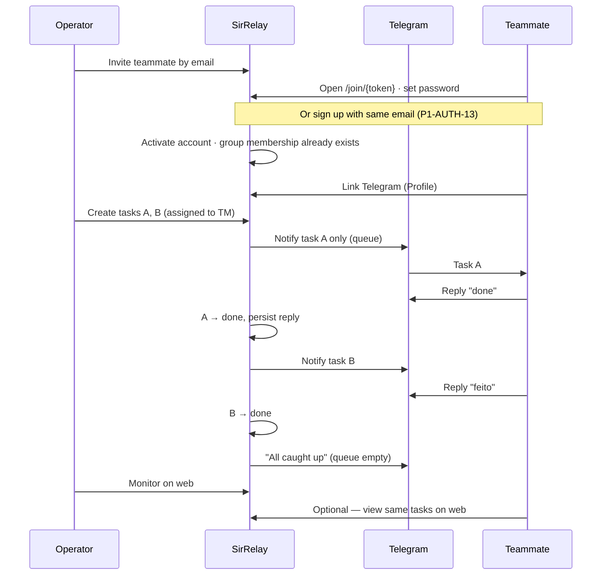

# SirRelay — Requirements

**Product:** SirRelay · **Brand:** Sir  
**Status:** Living spec — 3 phases, implement one at a time  
**Audience:** Developer / AI implementer  
**Last updated:** 2026-08-15

**Doc contract:** Source of truth for **what must work** — product rules, acceptance IDs, permissions, schema, API. **Layout / interaction / screen chrome** → [UIUX.md](./UIUX.md). **Visual tokens** → [BRAND.md](./BRAND.md). Do not restate wireframes or component inventories here.

Related docs: [UIUX.md](./UIUX.md) · [ARCHITECTURE.md](./ARCHITECTURE.md) · [BRAND.md](./BRAND.md) · [ENVIRONMENTS.md](./ENVIRONMENTS.md) · [DEPLOY-DIGITALOCEAN.md](./DEPLOY-DIGITALOCEAN.md) · [README.md](../README.md)

---

## 1. Product summary

**SirRelay** is a **hosted web task relay** for small teams (typically **2–5 people per group**), built by **Sir**. Public domain (DigitalOcean + HTTPS); data in **PostgreSQL**.

| Piece | Description |
|-------|-------------|
| **Marketing site** | Public `/[locale]` — layout in [UIUX.md §2.0](./UIUX.md#20-marketing-landing) |
| **Web app** | One account; work inside a **group**. Role (`operator` / `teammate`) is **per group** |
| **Telegram bot** | One task at a time to linked assignees; reply to update status |
| **Relay queue** | On `done`, next `todo` for that assignee is sent automatically |

**Account model:** Sign up → **create a group** (become operator) or **join** as teammate (invite link, panel paste, or **sign up with the invited email** — P1-AUTH-13). Same user may hold different roles in different groups. Active group via header switcher or `/groups`.

**Invite:** Operator sends invite by **email only** → `invited` user + teammate membership + invite link. Person activates via `/join/<token>` **or** `/signup` with the same email. Details: §5.1.2.

**In a group:** **Operator** — manage members/tasks, monitor web, Telegram relay + alerts. **Teammate** — Telegram primary; web My work / Team (edit own); may create self-assigned tasks. No web comment thread.

**Positioning:** No KPI dashboards, leaderboards, or surveillance metrics. **Clients:** web first (Phase 1); native apps → Phase 3 (P3-13).

**Languages:** UI locales `en-gb` · `es-es` · `pt-br` (DB may store short `en` / `es` / `pt`).

---

## 2. Core workflow



**Relay queue rules:**

1. Each **assignee** (teammate or operator) receives **at most one** active Telegram notification (`todo` or `doing`) for their own queue.
2. On task **create**: notify only if that assignee’s queue is empty (no other `todo`/`doing` task assigned to them). New tasks append to the **bottom** of that assignee’s To do queue (`sort_order`).
3. Queue order: **`sort_order ASC`**, then `due_date ASC NULLS LAST`, then `created_at ASC`. Web: operators can **drag to place/reorder** in any member’s To do; teammates reorder their own To do. Drop **inside** the To do scroll list inserts by Y position; drop on section chrome (header/footer) **appends**. Dropping onto another member’s To do (operator) reassigns and places at that index.
4. Queue **head** (what Telegram should show): any `doing` first (by order above), else the top `todo`. Reordering or status changes that change the head re-sync Telegram to that task.
5. On task **`done`**: send the next `todo` for that assignee (same order). If none remain: send a short “all caught up” message.

**Relay applies to any linked group member** — teammates and operators (including self-assigned tasks). Unlinked assignees stay on the web until they link Telegram on Profile.

---

## 3. Development phases

| Phase | Goal | Done when |
|-------|------|-----------|
| **1** | Workflow + deploy | Relay loop works; both roles on web; VPS + HTTPS |
| **2** | Security + audit + ops | Hardened app; `audit_logs` + Events activity; VPS runbook in README |
| **3** | Enhancements | Backlog items, one at a time |

Implement **one phase at a time**. Do not skip ahead unless explicitly requested.

---

## 4. Locked decisions

| Topic | Decision |
|-------|----------|
| Brand / app / repo | **Sir** · **SirRelay** · wordmark **SRelay** / mark **SR** · `sir-relay` |
| Telegram bot name | Display **SRelay** · `@SirRelayBot` |
| Web app | Single Next.js app; permissions scoped by **active group** + **membership role** |
| Roles | **Operator** — full edit in that group · **Teammate** — edit own tasks; may **view** all group tasks (Team scope) |
| Bootstrap (deploy) | On empty DB, seed one **user** from `ADMIN_EMAIL` + `ADMIN_PASSWORD` (may create first group manually) |
| Joining a group | **Create group** → creator is operator · **Invite** by email (link or panel paste) → join as teammate; **sign-up with invited email** activates the placeholder (P1-AUTH-13) |
| Task assignee | One user per task — any **active member** of the same group (teammate or operator, including other operators) |
| Relay scope | Telegram relay queue applies to **any linked assignee** in the group (teammate or operator, including self) |
| Operator alerts | Optional Telegram on Profile; notify on teammate **task done** and **due/overdue** (§5.6) |
| Task statuses | `todo` · `doing` · `done` |
| Relay | One Telegram notification per teammate at a time (§2) |
| Hosting | **DigitalOcean Droplet** (EU region) · Docker Compose · PostgreSQL · Caddy (HTTPS) |
| Stack | Next.js App Router · TypeScript · Prisma · grammy · next-intl · Tailwind · Zod |
| Visual identity | [BRAND.md](./BRAND.md) |
| **Product model** | **Hosted web app** (§4.1). Public landing + sign-in app on one domain. PostgreSQL persistence. |

### 4.1 Product model — Hosted web app (primary)

| Aspect | Decision |
|--------|----------|
| **Deployment** | One SirRelay stack on **DigitalOcean Droplet** (EU), public **domain + HTTPS** (Caddy). Same Docker Compose can run elsewhere if needed. |
| **Public entry** | `/[locale]` — marketing landing (logged-out visitors) |
| **Sign up / Log in** | `/[locale]/signup` · `/[locale]/login` — any user creates an account |
| **No active group** | `/[locale]/groups` — placeholder; group panel opens automatically |
| **Data** | **PostgreSQL** on the deployment; tasks, users, groups, and settings persisted server-side |
| **Accounts (Phase 1)** | Self-serve **sign-up** (anyone). User **creates a group** (operator) **or joins** as teammate — invite by email (link / panel / signup merge P1-AUTH-13). Role is **per group membership**, not stored on the user row. |
| **Session** | `{ userId, activeGroupId }`; effective `role` derived from `group_memberships` for the active group |
| **Multi-group** | One account may belong to many groups; **group switcher panel** or `/groups` when no active group |
| **Mobile** | Responsive web in Phase 1; native iOS/Android → Phase 3 (P3-13), same `/api/v1` |
| **Metrics / KPIs** | **Out of scope** — no velocity charts, leaderboards, or employee surveillance dashboards |
| **Multi-tenant SaaS** | Not Phase 1 — one organization per deployment. Many customers = many deployments (or P3-15). |
| **Private VPS / LAN** | Same Docker stack works elsewhere; Telegram webhook still needs a **public HTTPS URL**. |

---

## 5. Phase 1 — Core workflow & deploy

### 5.1 Authentication

| ID | Requirement | Acceptance criteria |
|----|-------------|---------------------|
| P1-AUTH-01 | Login | Email + password; invalid credentials → generic 401; **unverified email** (`email_verified_at` null) → blocked with resend (P3-MAIL-03); session stores `userId` + `activeGroupId`; **role** resolved from membership |
| P1-AUTH-02 | Logout | Clears session |
| P1-AUTH-03 | Session expiry | Default 7 days; override via `SESSION_MAX_AGE_DAYS` |
| P1-AUTH-04 | Bootstrap user | On empty DB, seed one user from `ADMIN_EMAIL` + `ADMIN_PASSWORD` |
| P1-AUTH-05 | First-login password change | **Bootstrap user only** (`must_change_password`); normal sign-ups skip forced change |
| P1-AUTH-06 | Password storage | bcrypt; minimum 8 characters |
| P1-AUTH-07 | Change password | Available on **Profile** (all users); optional forced flow via `/change-password` |
| P1-AUTH-08 | Update profile | `PATCH /me` — update own `name`, `locale` (`en-gb` \| `es-es` \| `pt-br`); avatar in later phase. **Only the account owner** may change `users.name` |
| P1-AUTH-09 | Group invite | Operator invites by **email** → invite link (72h) → `/join/<token>` → set password + name · **or** sign-up with same email (P1-AUTH-13) |
| P1-AUTH-10 | Post-login routing | No group → `/groups` · operator in active group → `/teammates` · teammate in active group → `/tasks` |
| P1-AUTH-11 | Sign up | `/signup` — name, email, password; **new email** → `email_verified_at` null + check-email (P3-MAIL-03), no group until create/join. **Invited email** → P1-AUTH-13 (verified) |
| P1-AUTH-12 | Active group | Session holds `activeGroupId`; all app data (tasks, teammates, alerts) scoped to active group |
| P1-AUTH-13 | Sign-up merge | Match **`invited`** placeholder → set name + password on that row, `account_status → active`, keep memberships, consume open invite tokens; **reject** if email is already **`active`** (“Email taken”) |
| P1-AUTH-14 | Post merge routing | After merge: set `activeGroupId` via pick-default (single group → that group; 2+ → last valid / null → `/groups`) → `resolveEntryPath` (teammate → `/tasks`) |
| P1-AUTH-15 | Delete account | Profile link → `/profile/delete` · password confirm · leave every group (same succession as leave) · delete assignee tasks · reassign remaining `created_by` to group owner · hard-delete user · clear session · **Done** |

### 5.1.1 Groups

| ID | Requirement | Acceptance criteria |
|----|-------------|---------------------|
| P1-GRP-01 | List | **Group switcher panel** lists groups with name + **role**; `/groups` is placeholder when no active group (panel opens) |
| P1-GRP-02 | Create | **Group switcher → Create group** (inline name ≥ 2 chars); creator is `operator` **and invisible group owner** (`groups.owner_user_id`); group becomes active |
| P1-GRP-03 | Select | **Group switcher** sets `activeGroupId` → role home |
| P1-GRP-04 | Auto-select | Single group + no active group → `GET /groups/auto` persiste cookie → role home; 2+ groups → `/groups` + panel open |
| P1-GRP-05 | Manage | **Group switcher panel** — switch, create, join · **Settings** — leave (active group), delete (**owner** only, active group) |
| P1-GRP-06 | Join via invite | `/join/<token>` (set password if `invited`) **or** paste in group panel (signed in, same email) **or** sign-up email match (§5.1.2 Path B) |
| P1-GRP-07 | Join from panel | Paste invite in group panel → accept when signed in; adds membership if missing |
| P1-GRP-08 | Existing active email | Operator adds teammate email that already has an **`active`** account → create/refresh one pending `group_invitation`; **do not** create membership until the user accepts |
| P1-GRP-09 | Leave group | Any member may leave **active** group. If leaver is **owner** and others remain: ownership → longest-standing other **operator**, else longest-standing **teammate** (auto-promoted to operator). Last member leave deletes the group |
| P1-GRP-10 | Delete group | **Owner** only; cascade tasks/teammates/alerts; session picks next group or `/groups` |
| P1-GRP-11 | Resume last group | `users.last_active_group_id` + session cookie; login with 2+ groups opens last valid group (not picker) |
| P1-GRP-12 | Invited email at operator add | Operator adds email with existing **`invited`** placeholder (same or other group) → add membership only; do not create duplicate user row |
| P1-GRP-13 | Invitation consent | Existing active user sees pending requests in the group switcher and may accept or decline; accept creates teammate membership transactionally, decline does not |
| P1-GRP-14 | Invitation lifecycle | One row per group/user; 72h expiry; operator sees pending/declined/expired and may resend; accepted requests are retained as history |
| P1-GRP-15 | Transfer ownership | **Owner** only; pick any **active** member; target becomes operator if needed; previous owner stays operator. Owner not shown as a separate UI role |

### 5.1.2 Invite activation

Operator **invite** ≠ operator-owned login. The operator reserves **email + group role only**; the **person** chooses name and how to activate.

| Path | Who | Result |
|------|-----|--------|
| **A — Invite link** | Person opens `/join/<token>` | Set **name + password** (if `invited`) or accept (if already logged in with matching email) → `active` → already in group |
| **B — Sign up (email match)** | Person uses `/signup` with **same email** as invite | Merge into existing `invited` row — signup **name + password** win, memberships kept, `active`, tokens consumed → auto-join per P1-AUTH-14 |
| **C — Already active account** | Person already signed up elsewhere | Operator creates a pending request (email only; opaque success); person accepts in the group switcher before membership is created (P1-GRP-08/13/14) |

Sign-up must **not** fail with “email taken” when the only existing row is **`invited`**. Sign-up must **fail** when email belongs to an **`active`** user — they should log in instead.

**Operator visibility:** invite link + account/Telegram **status** on teammate detail; **no** operator access to the teammate’s Telegram link (self-service on **Profile** — P1-TG-11 / P1-TM-07). Invite-by-email must not reveal whether the address already exists beyond group-scoped outcomes (`already_in_group` / pending invite created).

### 5.1.3 Identity & display names

| Field | Owner | Scope |
|-------|--------|--------|
| `users.name` (account name) | **Account owner only** (Profile / signup / join) | Global |
| `group_memberships.display_name` (fantasy / group label) | **Operator in that group** or **the member themselves** | Per membership |
| Email | Owner; operator may change only while `invited` | Global unique |

**Group UI label:** `display_name ?? users.name`; if account name is empty (invited pending), show **email**. Lists also show account status **Pending** / **Invited**.

Operators **must not** write `users.name` for another person (closes the teammate “Edit name” hole that mutated global identity).

### 5.2 Teammates

Operator-only management **within the active group** (except fantasy name, which the member may also edit).

| ID | Requirement | Acceptance criteria |
|----|-------------|---------------------|
| P1-TM-01 | Invite | **Email only**; creates **`invited`** user (no password; account name unset until activation) + teammate membership — **not** an operator-created login |
| P1-TM-02 | List | Group label (`display_name ?? name`, or email while pending), email, account (`invited` / `active`), Telegram (`linked` / `pending`) |
| P1-TM-03 | Remove from group | In one transaction, permanently delete tasks assigned to that user in the active group, invalidate open group invites, and delete the membership. Preserve the global account and tasks assigned to other users. The same email can be added again. |
| P1-TM-04 | Edit (operator) | Set/clear **group `display_name`**; change email only while `invited`. **Never** patch another user’s `users.name` |
| P1-TM-05 | Invite link | One-time token (72h); share link; activation via `/join/<token>` or signup merge (P1-AUTH-13) |
| P1-TM-06 | Regenerate invite | New token if expired and account still `invited` |
| P1-TM-07 | Link Telegram | Self-service on **Profile** — one-time code (72h); `t.me/<bot>?start=<code>`. Linked users get **task relay** when assigned; operators **also** get **alert** DMs |
| P1-TM-08 | Regenerate Telegram link | **Profile** — new code if expired (operators + teammates) |
| P1-TM-09 | One chat per teammate | `telegram_chat_id` unique across users |
| P1-TM-10 | Promote to operator | Operator promotes **active** teammate in group → `group_memberships.role = operator`; appears as operator in team list |
| P1-TM-11 | Fantasy name | Optional `group_memberships.display_name`; editable by operator on member detail **or** by the member on **Settings**; empty → fall back to account name |
| P1-TM-12 | Demote to teammate | Operator demotes another **operator** → teammate; **blocked** for group **owner** and for the last operator |
| P1-TM-13 | Remove vs owner | Cannot remove the group **owner**; transfer ownership first |

### 5.3 Tasks & relay queue

| ID | Requirement | Acceptance criteria |
|----|-------------|---------------------|
| P1-TASK-01 | Create | **Operator:** title + assignee (any active group member, including self and other operators). **Teammate:** title + self only (assignee forced to signed-in user). Optional description, due_date, difficulty (`easy`/`medium`/`hard`) |
| P1-TASK-02 | Notify on create | Send Telegram if assignee is **linked** **and** their queue is empty (§2) |
| P1-TASK-03 | Re-notify | Operator only; resend Telegram; update `telegram_message_id` (replies bind to latest message) |
| P1-TASK-04 | List / Kanban | Both roles: **My work** (own) · **Team** (group). Teammate Team = view others, edit own only |
| P1-TASK-05 | Update / delete | Operator: any field on any task · Teammate: edit + delete own tasks (title, status, due, description, difficulty) |
| P1-TASK-06 | Detail | Editable form when allowed + Telegram delivery banner; teammate **read-only** on others’ tasks; **no web comment UI** |
| P1-TASK-07 | Due date | Optional `DATE`; overdue when `due_date` < today UTC |
| P1-TASK-08 | Limits | Title ≤ 200 · description ≤ 10 000 |
| P1-TASK-09 | Reply threading | Store `telegram_message_id` + `telegram_chat_id` on each notify; replies must reference latest message |
| P1-TASK-10 | Status sync | Telegram keyword or web update persists immediately for both roles |
| P1-TASK-11 | Queue order | Next / head: `sort_order ASC`, then `due_date ASC NULLS LAST`, then `created_at ASC`. Web: drag to place/reorder in editable To do columns; drop inside scroll list = insert by Y, drop on section chrome = append; Telegram follows queue head |
| P1-TASK-12 | Auto-dispatch | On `done` (Telegram keyword or web): notify next task per P1-TASK-11; if none, send queue-empty message (P1-TG-08). Same for teammate **and** operator assignees. |
| P1-TASK-13 | Operator self-tasks | Operator may assign tasks to themselves (or other operators); visible on web board in the **self column** (member label, not “Me”) and other member columns; **Telegram relay** when linked (same queue rules as teammates) |
| P1-TASK-14 | Clone | Who can **create** a task for that assignee may clone an editable task. Copy title, description, due, difficulty, assignee, status; insert **immediately below** source in that status queue (`sort_order`). Does not copy Telegram message ids. UI: board **⋯** menu — [UIUX.md §4](./UIUX.md#4-task-card) |

### 5.4 Telegram activity (no web comment UI)

Web app has **no comment thread**. Telegram replies are persisted for relay/audit only.

| ID | Requirement | Acceptance criteria |
|----|-------------|---------------------|
| P1-CMT-01 | Telegram reply log | Reply to latest notification creates a server record (`source: telegram`); may update status (P1-TG-04) |
| P1-CMT-02 | Limits | Body ≤ 2 000 characters |

### 5.5 UI & i18n

| ID | Requirement | Acceptance criteria |
|----|-------------|---------------------|
| P1-UI-01 | Branding | Logos / tokens per [BRAND.md](./BRAND.md) |
| P1-UI-02 | App nav | Active-group nav (both roles): Tasks · Teammates · **Projects** · Events · Settings. Profile via avatar / sidebar footer. Teammate: Teammates + Events read-only; group activity operator-only — [UIUX.md §2.2](./UIUX.md#22-app-shell) |
| P1-UI-03 | Marketing landing | Public `/[locale]` when logged out — [UIUX.md §2.0](./UIUX.md#20-marketing-landing) |
| P1-UI-04 | Landing entry | Locale switcher + **Sign up** / **Log in** — details in UIUX §2.0 |
| P1-UI-05 | Product demo | Hero demo video + CSS fallback — details in UIUX §2.0 |
| P1-UI-06 | No metric UI | No velocity charts, leaderboards, or employee KPI dashboards in Phase 1–2 |
| P1-UI-07 | App store links | **None** in Phase 1 — web only; native store badges → P3-13 |
| P1-VIEW-01 | List sort | By due date, status, updated_at |
| P1-VIEW-02 | Task boards | **My work** Kanban · **Team** member columns — layout [UIUX.md §3](./UIUX.md#3-task-boards--scope--layout). Operator edits all; teammate edits own only |
| P1-VIEW-03 | List view | Both roles; My work / Team scope; sort/filter; mobile fallback |
| P1-VIEW-04 | Responsive | Usable at 375px — [UIUX.md §12](./UIUX.md#12-responsive-summary) |
| P1-I18N-01 | Locales | Full UI in `en-gb` · `es-es` · `pt-br` via next-intl |
| P1-I18N-02 | User locale | Persisted on account; selectors on login, header (URL), and **Profile** (`PATCH /me`) |
| P1-I18N-03 | Telegram copy | Per-user locale; fallback `en-gb` — message shapes in [UIUX.md §10](./UIUX.md#10-telegram-ux-companion-to-web) |

### 5.6 Telegram bot

| ID | Requirement | Acceptance criteria |
|----|-------------|---------------------|
| P1-TG-01 | Webhook | `POST /api/v1/telegram/webhook` |
| P1-TG-02 | Task message | Title, description (truncated to 500 chars + `…`), due date, optional difficulty, reply instruction |
| P1-TG-03 | Reply → comment | Reply to latest notification creates comment |
| P1-TG-04 | Status keywords | Case-insensitive match on reply: **→ `done`:** `done`, `hecho`, `concluída`, `feito`, `listo` · **→ `doing`:** `in progress`, `em progresso`, `en progreso`, `working` · Persist comment + status in one transaction; `done` triggers P1-TASK-12 |
| P1-TG-05 | Authorization | Ignore unlinked chats; ignore replies to tasks not assigned to sender |
| P1-TG-06 | `/start <code>` | Links Telegram chat; send welcome confirmation |
| P1-TG-07 | Delivery warnings | Task always saves; web warns if Telegram pending or API failed |
| P1-TG-08 | Queue empty | Localized short message when no next `todo` (e.g. “All caught up — no more tasks.”) |
| P1-TG-09 | Operator alert — task done | When a teammate marks a task `done` (Telegram keyword or web), send a Telegram message to **each Operator** with linked Telegram: task title, teammate name, timestamp |
| P1-TG-10 | Operator alert — due / overdue | Daily job (UTC): for each teammate task with `due_date` ≤ today and status ≠ `done`, notify linked Operators once per task per due day (dedupe); message includes title, assignee, due date, overdue flag |
| P1-TG-11 | Telegram link (self) | **Profile** for all roles — **task relay** when assigned + **operator alerts** when role is operator; operator **does not** generate another user’s Telegram link |

### 5.7 Security (minimum to ship)

Full hardening → Phase 2.

| ID | Requirement |
|----|-------------|
| P1-SEC-01 | HTTPS in production (Caddy TLS) |
| P1-SEC-02 | Secrets in env; ship `.env.example`; no secrets in git |
| P1-SEC-03 | Authenticate all `/api/v1/*` except login, join, health, webhook; enforce role + ownership (§8) |
| P1-SEC-04 | JWT in httpOnly cookie; `Secure` in production |
| P1-SEC-05 | Prisma parameterized queries; React escapes output |
| P1-SEC-06 | Invite and Telegram link tokens: store hash only; single-use; 72h expiry |
| P1-SEC-07 | Verify `X-Telegram-Bot-Api-Secret-Token` on webhook |

### 5.8 Deploy

| ID | Requirement |
|----|-------------|
| P1-DEP-01 | `docker-compose.yml`: app, postgres, umami, Caddy |
| P1-DEP-02 | `docker compose up -d` starts the stack |
| P1-DEP-03 | Postgres persistent volume |
| P1-DEP-04 | README + deploy doc | Env setup, DNS, first login, landing at `/`, Telegram webhook — [DEPLOY-DIGITALOCEAN.md](./DEPLOY-DIGITALOCEAN.md) |
| P1-DEP-05 | Next.js `output: 'standalone'` |
| P1-DEP-06 | `GET /api/v1/health` → `{ "ok": true, "service": "sirrelay" }` · fail: `503` + `{ "ok": false, "error": "database_unavailable" }` |
| P1-DEP-07 | Versioned Prisma migrations |

**Environment variables:**

| Variable | Required | Notes |
|----------|----------|-------|
| `APP_URL` | Yes | Public URL for links and webhook |
| `DATABASE_URL` | Yes | PostgreSQL connection string |
| `SESSION_SECRET` | Yes | JWT signing key |
| `SESSION_MAX_AGE_DAYS` | No | Default `7` |
| `ADMIN_EMAIL` | Yes | Seeds bootstrap **user** on first deploy |
| `ADMIN_PASSWORD` | Yes | Seeds bootstrap **user** on first deploy |
| `PLATFORM_ADMIN_USERNAME` | No* | Ops console `/platform/login` (separate from product login) |
| `PLATFORM_ADMIN_PASSWORD` | No* | ≥8 chars; required with username to enable `/platform` |
| `TELEGRAM_BOT_TOKEN` | Yes | From BotFather |
| `TELEGRAM_WEBHOOK_SECRET` | Yes | Webhook verification |

\*Required in prod if you use the platform admin console (P2-AUD-04).

### 5.9 Data model

```
users
  id, name, email, password_hash, locale,
  telegram_chat_id, active, must_change_password, account_status,
  email_verified_at (nullable), terms_version, terms_accepted_at,
  last_active_group_id, created_at, updated_at

email_tokens
  id, user_id, type (email_verify|password_reset), token_hash,
  expires_at, used_at, created_at

groups
  id, name, owner_user_id, created_at, updated_at

group_memberships
  group_id, user_id, role (operator|teammate), display_name (nullable), created_at
  UNIQUE (group_id, user_id)

group_invitations
  id, group_id, invited_user_id, invited_by_user_id,
  role (teammate), status (pending|accepted|declined),
  expires_at, responded_at, created_at, updated_at
  UNIQUE (group_id, invited_user_id)

teammate_invite_tokens
  id, user_id, token_hash, expires_at, used_at, created_at

telegram_link_tokens
  id, user_id, token_hash, expires_at, used_at, created_at

tasks
  id, group_id, title, description, assignee_id, created_by_id,
  status (todo|doing|done), difficulty (easy|medium|hard|null), due_date, sort_order,
  project_id (nullable), category_id (nullable),
  telegram_message_id, telegram_chat_id, telegram_notified_at, telegram_notify_failed,
  created_at, updated_at

projects
  id, group_id, name, acronym, archived_at (null = not archived), pending_at (null = accepted), created_at

project_categories
  id, project_id, name, archived_at, created_at

telegram_activity   -- optional audit log for Telegram replies (not shown on web)
  id, task_id, body, author_user_id, created_at
```

- **No `role` on `users`** — role lives on `group_memberships`
- `assignee_id` → `users.id` (teammate **or** operator in the same group)
- `created_by_id` → creating member in that group (operator or teammate)
- All task/teammate queries filter by `session.activeGroupId`

### 5.10 Routes

**Access matrix** (`/[locale]/`). Screen chrome and empty states: [UIUX.md §6](./UIUX.md#6-screen-inventory).

| Route | Operator in group | Teammate in group | Notes |
|-------|-------------------|-------------------|-------|
| `/` (locale home) | Redirect if session | Redirect if session | Public landing when logged out |
| `login`, `signup` | Public | Public | Account entry |
| `forgot-password`, `reset-password`, `verify-email`, `check-email` | Public | Public | P3-17 |
| `contact` | Public | Public | Contact → `CONTACT_EMAIL` |
| `groups` | Yes | Yes | No active group; panel opens |
| `privacy`, `terms` | Public | Public | Legal |
| `join/[token]`, `change-password` | — | — | Auth flows |
| `profile`, `profile/delete` | Yes | Yes | Global account · hard-delete confirm (P1-AUTH-15) |
| `tasks` | My work / Team | My work / Team (edit own) | Board \| List |
| `tasks/new` | Yes | Yes (self only) | |
| `tasks/[id]` | Yes | Own editable · others read-only | |
| `teammates` | Yes | Read | List |
| `teammates/new` | Yes | — | Invite |
| `teammates/[id]` | Yes | Read | Mutate: operator |
| `projects` | Yes | Yes | Manage group projects + categories (nav tab) |
| `events` | Yes | Read alerts | |
| `events/activity` | Yes | — | Group history |
| `settings` | Yes | Yes | Group prefs, leave/delete |
| `platform/*` | — | — | Ops cookie (`PLATFORM_ADMIN_*`), not product session |

**Phase 1 acceptance test:** Landing → sign up → create group → invite teammate → activate via `/join/<token>` **or** signup with same email → link Telegram on Profile → two tasks → relay `done` on Telegram. **Or** demo `sam@example.com` → Demo Shop. VPS + HTTPS.

---

## 6. Phase 2 — Security, audit & operations

### 6.1 Application security

| ID | Requirement | Acceptance criteria |
|----|-------------|---------------------|
| P2-SEC-01 | IDOR protection | Every resource route validates role + ownership · **Done** (service-layer: `authz.ts` + operator on export/alert prefs/invites; any member on alert list; self-only on UserService; task mutations via `assertCanMutateTask`) |
| P2-SEC-02 | Session revocation | `token_version` on user; increment on password change; invalidate on logout · **Done (SEC base)** |
| P2-SEC-03 | Account lockout | 5 failed logins per email per 15 min → lock 15 min · **Done (SEC base)** |
| P2-SEC-04 | Password policy | Min 8 + uppercase + number; block common passwords · **Done (grandfather: only on set)** |
| P2-SEC-05 | Security headers | HSTS, `X-Frame-Options: DENY`, `X-Content-Type-Options: nosniff`, `Referrer-Policy`, CSP · **Done (`proxy.ts`)** |
| P2-SEC-06 | CSRF | SameSite=Lax session cookie + `proxy.ts` Origin/Referer check on non-GET locale routes · **Done (no token; upgrade if cookie REST API)** |
| P2-SEC-07 | Rate limits | Login/signup/`platform/login` 10/min/IP · other mutations 100/min/IP · in-memory in `proxy.ts` · **Done** (Redis if multi-instance) |
| P2-SEC-08 | Login errors | Generic message; no email enumeration on **login** · **Done** (always `Invalid credentials` / `auth.loginError`; signup “taken” is intentional for new accounts) |
| P2-SEC-09 | Telegram input | Sanitize; strip control characters · **Done** (`sanitizeTelegramText` / link codes on inbound bot handlers) |
| P2-SEC-10 | Dependency audit | Run/document `npm audit` before deploy; no critical in prod · **Done** (Next **16.2.10**; no high in `audit:prod`; nested postcss moderate remains) |
| P2-SEC-11 | Safe logging | Never log passwords, tokens, or full comment bodies; JSON logs · **Done** (`safe-log.ts` + redaction; login / CSRF / rate-limit / telegram errors). Request id → P2-MON-01 |

### 6.2 Audit log & group activity

Server writes append-only `audit_logs` via `writeAudit` (security + ops). Operators see **group activity** (`listGroupActivity` → `/events/activity`, human language). Login / logout / password stay in the store for **platform admin** (`/platform`) — not in the group UI.

| ID | Requirement | Acceptance criteria |
|----|-------------|---------------------|
| P2-AUD-01 | Recorded actions | Login, **login_failed**, logout, password change, invite, Telegram link, task CRUD, notify, reply, status change, relay dispatch, **export_data** · **Done** (`writeAudit` / `writeAuditFromSession`) |
| P2-AUD-02 | Storage | `audit_logs`: id, action, actor_type, actor_id, metadata, created_at · **Done** |
| P2-AUD-03 | Group UI | `/[locale]/events` = alerts (both roles, teammate read-only); `/events/activity` = group history (operator only; human language; no login/logout) · **Done** |
| P2-AUD-04 | Platform admin | `/{locale}/platform/*` with **separate** env credentials (`PLATFORM_ADMIN_USERNAME` / `PLATFORM_ADMIN_PASSWORD`) + cookie `sirrelay_platform_session` · **Done** (no public audit API; not product login) |

**Schema addition:**

```
users.token_version        INT DEFAULT 0
users.failed_login_count   INT DEFAULT 0
users.locked_until         TIMESTAMP NULL

audit_logs
  actor_type: operator | teammate | system
```

### 6.3 VPS operations

Runbook: [DEPLOY-DIGITALOCEAN.md](./DEPLOY-DIGITALOCEAN.md) (firewall · SSH · `.env` · backups · updates). README aponta para esse guia.

| ID | Requirement | Status |
|----|-------------|--------|
| P2-OPS-01 | Firewall: ports 22 (SSH restricted), 80, 443 | **Done** — DEPLOY §3 |
| P2-OPS-02 | Postgres not public; Docker internal network | **Done** — `docker-compose.yml` (`internal`; só Caddy publica 80/443) |
| P2-OPS-03 | SSH key-only | **Done** — DEPLOY §1–2 · `bootstrap-droplet.sh` |
| P2-OPS-04 | Daily SQL backup — §6.5.1 | **Done** — cron 05:00 → Drive |
| P2-OPS-05 | Restore procedure tested once — §6.5.1 | **Done** — DEPLOY §9.1 |
| P2-OPS-06 | Containers run as non-root | **Done** — `Dockerfile` `USER nextjs` |
| P2-OPS-07 | `.env` file mode `600` | **Done** — DEPLOY §6 · ENVIRONMENTS |
| P2-OPS-08 | `SESSION_SECRET` ≥ 32 random bytes | **Done** — `openssl rand -base64 32` in DEPLOY / `.env.example` |
| P2-OPS-09 | Monthly OS and image updates | **Done** (procedure) — DEPLOY §9 “Updates mensais” |

### 6.4 Monitoring

**Two layers** — do not conflate them:

| Layer | Answers | Tooling |
|-------|---------|---------|
| **Audit log** (P2-AUD) | Who did what? (login, task CRUD, invite, relay) | `audit_logs` · `/events/activity` · `/platform` |
| **Access / ops** | Is the app up? Who hit the server? | Caddy access logs, `GET /health`, JSON app logs |

**Product analytics:** self-hosted **Umami** in Docker Compose (service always present in prod-local/VPS; DB `umami` via `ensure_umami_database` in `scripts/env/_common.sh`). Tracker same-origin via Caddy (`/script.js`, `/api/send`) — CSP stays `'self'`. Dashboard: local `:3001` · VPS `analytics.<APP_ROOT_DOMAIN>`. Per environment: **Add website** (domain = that env’s `APP_DOMAIN`) and set `UMAMI_WEBSITE_ID` (script injects only when set). No Google Analytics / third-party SaaS. No consent banner (cookieless tracker; privacy page discloses).

| ID | Requirement | Acceptance criteria |
|----|-------------|---------------------|
| P2-MON-01 | Structured app logs | JSON logs: request id, user id (if session), route, status; never log passwords or tokens · **Done** (`x-request-id` in `proxy.ts` · auto on `logJson` / `logJsonAsync`; no per-request start/end spam). Docker log rotation: `max-size` 10m × 5 |
| P2-MON-02 | Failed login visibility | **Done** — `login_failed` in `audit_logs` (reason + email; platform `/platform` + Audit filter). Operator alert threshold → Phase 3 |
| P2-ANA-01 | Self-hosted Umami | Compose service `umami` · DB `umami` · `UMAMI_APP_SECRET` |
| P2-ANA-02 | Same-origin tracker | Caddy proxies `/script.js` + `/api/send` · app loads `/script.js` when `UMAMI_WEBSITE_ID` set (`src/lib/umami.ts`) |
| P2-ANA-03 | Privacy disclosure | `/privacy` + `/terms` from canonical English pack `legal/en.json` · contact via `/contact` → `CONTACT_EMAIL` (default `contact@sirrelay.com`) |
| P2-LEGAL-01 | Legal acceptance | `users.terms_version` + `terms_accepted_at` · signup checkbox · `/accept-terms` gate when version ≠ `CURRENT_LEGAL_VERSION` · bump version in `legal/en.json` to force re-accept |

**Cookies (current):** one essential session cookie + login notice + Privacy Policy. Umami tracker is cookieless (no advertising cookies). Contact: public `/contact` → `CONTACT_EMAIL` (e.g. `contact@sirrelay.com`). Canonical acceptance language: **English** (`legal/en.json`).

### 6.5 Data backup & export

| Layer | Purpose | Who |
|-------|---------|-----|
| **SQL backup** | Full disaster recovery | Admin via SSH / cron |
| **App export** | CSV snapshot (members + tasks; alert prefs on full) | Operator via Teammates UI |

#### 6.5.1 SQL backup (ops)

| ID | Requirement | Acceptance criteria |
|----|-------------|---------------------|
| P2-BAK-01 | Scripts | `scripts/db/backup.sh` (`pg_dump` → gzip `backups/{sirrelay,umami}-YYYYMMDD-HHMM.sql.gz`; skips `umami` if DB missing) · `scripts/db/restore.sh` (stop app/umami → restore matching DB → restart) · `scripts/db/backup-offsite.sh` (rclone both patterns); documented in README + [DEPLOY-DIGITALOCEAN.md §9.1](./DEPLOY-DIGITALOCEAN.md) |
| P2-BAK-02 | Schedule & retention | **Done (prod VPS):** daily cron `0 5 * * *` → `backup-offsite.sh`; prune local copies older than 7 days (`BACKUP_RETAIN_DAYS`) |
| P2-BAK-03 | Off-VPS copy | **Done:** Google Drive via rclone (`gdrive:sirrelay-backups`) |
| P2-BAK-04 | Restore tested | **Done:** restore exercised; rely on offsite + local `.sql.gz` for recovery |

**Out of scope:** in-app SQL download · import/restore from export (not planned).

#### 6.5.2 App export (CSV)

| ID | Requirement | Acceptance criteria |
|----|-------------|---------------------|
| P2-DATA-01 | Export | Operator via **server action** (Teammates UI); full group or per-person · **Done** |
| P2-DATA-02 | CSV download | UTF-8 BOM · RFC4180 · sections: Members, Tasks, Alert preferences (full only) · never include password/token hashes or Telegram chat/message ids · **Done** (`toExportCsv`; `check:export-csv`) |
| P2-DATA-03 | UI | [UIUX.md §7](./UIUX.md#7-teammates-operator) · **Done** |

- **`scope: full`** — active members + all group tasks + operator alert prefs.
- **`scope: user`** — one member + their assigned tasks (no alert prefs).

---

## 7. Phase 3 — Backlog

| ID | Feature |
|----|---------|
| P3-03 | Kanban DnD polish (touch / keyboard a11y) — core To do reorder + status/reassign drops shipped in Phase 1 |
| P3-04 | Web comment thread (view/add on task detail) |
| P3-06 | Daily digest to Operator Telegram |
| P3-07 | Offline web sync |
| P3-08 | Slack integration |
| P3-09 | 2FA / TOTP for Operator |
| P3-10 | Custom branding overrides |
| P3-11 | Logo collapse animation ([BRAND.md](./BRAND.md) §3.3) |
| P3-13 | Native mobile apps (iOS / Android) — same `/api/v1`; web remains primary until shipped |
| P3-14 | PWA install + optional push notifications |
| P3-15 | Public organization signup (multi-tenant or self-serve deploy) |
| P3-16 | Group projects — acronym on tasks; Projects tab + categories |

### 7.3 Transactional email (P3-17) — **Done**

**Inbound:** `contact@sirrelay.com` → ImprovMX → operator inbox ([DEPLOY §4](./DEPLOY-DIGITALOCEAN.md#4-dns)). **Outbound:** Resend (`MAIL_API_KEY` / `MAIL_FROM`); from `noreply@sirrelay.com`. No MTA on the Droplet. Env: [ENVIRONMENTS.md](./ENVIRONMENTS.md).

| ID | Requirement | Acceptance criteria |
|----|-------------|---------------------|
| P3-MAIL-01 | Provider | **Done** — `sendMail` / `sendContactMail` in `lib/mail`; Resend when `MAIL_API_KEY` set; else log-only. Templates `en-gb` / `es-es` / `pt-br`. |
| P3-MAIL-02 | Contact | **Done** — Public `/contact`: name, email, message. Honeypot + rate limit. Delivers to `CONTACT_EMAIL`. Generic success. |
| P3-MAIL-03 | Signup verify | **Done** — New signup → `email_verified_at` null + link (~24h, hashed). Login blocked until verified (+ resend). `/join` + demo `prisma/seed` → verified. Invited merge (P1-AUTH-13) → verified. Mock skips inbox verify (one-click demos). |
| P3-MAIL-04 | Forgot password | **Done** — `/forgot-password` + `/reset-password`. Always generic response (no enumeration). Token ~1h, single-use, hashed. |
| P3-MAIL-05 | Schema | **Done** — `users.email_verified_at`; `email_tokens` (`email_verify` \| `password_reset`); `check:email-tokens`. |

### 7.1 Offline web sync (P3-07)

Both roles. Requires Phase 1 API + DB. PWA install → P3-14. Out of scope here: Service Worker, multi-tab coordination.

| ID | Requirement | Acceptance criteria |
|----|-------------|---------------------|
| P3-OFF-01 | Session task state | Web edits update UI immediately in memory; full page load fetches server; unsent changes lost on refresh |
| P3-OFF-02 | Mutation queue | In-memory pending writes `{ clientMutationId, type, taskId, payload, baseUpdatedAt }`; MVP types: `update_status`, `reassign` (Operator); permissions per §8 |
| P3-OFF-03 | Sync attempt | On each mutation, call API first; enqueue only on failure (network, timeout, 5xx) |
| P3-OFF-04 | No revert on failure | Failed sync keeps session UI + queue until success or conflict resolution; refresh loads server |
| P3-OFF-05 | Sync bar | Top bar when queue non-empty after retry threshold; `en` / `es` / `pt`; states: syncing, failed, conflict; hidden when synced |
| P3-OFF-06 | Sync now | Replays queue against §9 routes; partial failure lists failed items; full success clears banner |
| P3-OFF-07 | Auto-retry | Optional: retry queue on browser `online` event |
| P3-OFF-08 | Idempotent writes | `PATCH /tasks/:id` accepts optional `clientMutationId`; duplicate replay → 200, no double write |
| P3-OFF-09 | Conflicts | `PATCH /tasks/:id` accepts optional `baseUpdatedAt`; server newer → `409` + task snapshot; user picks keep local or use server |
| P3-OFF-10 | Relay | P1-TASK-12 runs only after server persist; offline delay acceptable |

### 7.2 Group projects (P3-16)

Optional labels **inside the active group**. The group remains the team (members, board, Telegram queue). A **project** is a named bucket with a short **acronym**; a task may carry at most one. CRUD lives on the **Projects** nav tab (`/projects`, between Teammates and Events). The board shows the acronym; the list view filters and inline-edits title, project, and category. Categories live **on the project**; a task may carry at most one (`category_id`) from its current project. Not on the task card.

Out of scope: free-form tags, colours, people-per-project, per-project boards, nested categories, category on task cards / Telegram heading.

```
Group → projects (open | pending | archived)
Project → categories (open | archived)
Task.project_id → nullable FK
Task.category_id → nullable FK (SET NULL; must belong to the task’s project)
```

| ID | Requirement | Acceptance criteria |
|----|-------------|---------------------|
| P3-PRJ-01 | Scope | Projects belong to `session.activeGroupId`. Switching group switches the list. |
| P3-PRJ-02 | Manage UI | Both roles: **Projects** tab **`/projects`**. Operator: create (name then acronym), list, accept pending, trash. Teammate: request; cannot trash a project. Both roles: add / archive categories on accepted projects. Pending rows show until an operator accepts. |
| P3-PRJ-03 | Acronym | 1–3 letters A–Z (store uppercase). Unique among **open and pending** projects in the group. |
| P3-PRJ-04 | Archive | Trash on `/projects` archives (not hard-delete). Hides from create/edit Select. Existing tasks keep `project_id`; acronym still renders. Operator may trash a pending request (frees a pending slot). |
| P3-PRJ-05 | Tag task | Create/edit: Select of **accepted open** projects; optional (`null` = untagged). One project per task. Clone copies `project_id` (and `category_id` if still open on that project) if the project is still accepted-open, else both `null`. Pending is not taggable. |
| P3-PRJ-06 | List filter | List view: Select of **accepted open** projects with the other list filters (`All` or one project). Board / kanban: no project filter (all tasks in scope). Zero projects: quiet link to `/projects` (both roles). |
| P3-PRJ-07 | Display | Board, task detail, Telegram: `SIR · Fix login`. Card: click acronym → retag; click title → edit title only. Untagged: title only. Category is **not** shown on the card. **List:** Title, Project, Category, assignee, status, due. Click title → input (≤200, wrap 2 lines); click project/category/assignee/status → vertical picker (assignee: operator). Click due → date. Changing project clears the category unless that category id still exists on the new project. |
| P3-PRJ-08 | Relay | Queue / notify / re-notify use the same display string. Project does not change queue order. |
| P3-PRJ-09 | Permissions | Operator: create / accept / archive project. Teammate: request project (not archive). Both roles: add / archive **categories** on accepted projects; set **accepted** project and that project’s **category** on tasks they can edit. |
| P3-PRJ-10 | Schema | `projects`: `id`, `group_id`, `name` (≤20), `acronym` (1–3), `archived_at`, `pending_at`, `created_at`. `project_categories`: `id`, `project_id`, `name` (≤20), `archived_at`, `created_at`. `tasks.project_id` and `tasks.category_id` nullable FKs `on delete set null`. |
| P3-PRJ-11 | Cap | At most **14** accepted-open projects per group. Refuse operator create and teammate request at the cap. Accept refused at the cap. |
| P3-PRJ-12 | Pending cap | At most **2** pending requests per group (`archived_at` null and `pending_at` set). Any operator may accept. Refuse further teammate requests at the cap. |
| P3-PRJ-13 | Categories | Per **accepted** project. Both roles: add name, list, trash (archives). Unique name among open categories of that project (case-insensitive). Cap **8** open per project. No categories on pending projects. Task may set `category_id` of a category on its current project (list + later detail); clear when the project is cleared. |

---

## 8. Permissions

Permissions apply **within the active group**. The same user may be operator in group A and teammate in group B — switching group changes what they can do.

| Action | Operator (in group) | Teammate (in group) | Teammate (Telegram) |
|--------|---------------------|---------------------|---------------------|
| Sign up / log in | Yes | Yes | — |
| Create group | Yes (becomes operator + invisible owner) | Yes (becomes operator + invisible owner) | — |
| Switch active group | Yes | Yes | — |
| Leave group | Yes (owner leave → ownership succession) | Yes | — |
| Delete group | Yes (owner only) | — | — |
| Transfer ownership | Yes (owner only) | — | — |
| Promote teammate → operator | Yes | — | — |
| Demote operator → teammate | Yes (not owner / not last operator) | — | — |
| Manage teammates | Yes | — | — |
| View teammates | Yes | Yes (read) | — |
| Create / edit / delete tasks | Yes | Own tasks only | — |
| Clone task | Yes (any editable) | Own tasks only | — |
| View tasks | All in group | All in group (edit own only) | Current notification |
| Change status | Yes | Own tasks (`done` → relay) | Keywords (`done` → relay) |
| Telegram reply log | — | — | Reply (stored server-side) |
| Re-notify | Yes | — | — |
| Link Telegram | Self-link on **Profile** (relay + alerts if operator) | Self-link on **Profile** (relay) | `/start <code>` |
| View alerts | Yes (`/events`) | Yes (read) | — |
| Group activity | Yes (`/events/activity`) | — | — |
| Export data (CSV) | Yes | — | — |
| Manage group projects | Yes (create / accept / archive) | Request only (read list) | — |
| Manage project categories | Yes | Yes | — |
| Tag task with project | Yes | Own tasks only | — |

---

## 9. API contract

Base path: `/api/v1` · Error format: `{ "error": "code", "message": "string" }`

| Method | Path | Phase | Auth |
|--------|------|-------|------|
| POST | `/auth/login` | 1 | Public |
| POST | `/auth/signup` | 1 | Public — new email · or merge `invited` placeholder (P1-AUTH-13) |
| POST | `/auth/join` | 1 | Public `{ token, password }` |
| POST | `/auth/logout` | 1 | Session |
| POST | `/auth/change-password` | 1 | Session |
| GET | `/me` | 1 | Session |
| PATCH | `/me` | 1 | Session `{ name?, locale? }` |
| POST | `/me/active-group` | 1 | Session `{ groupId \| null }` |
| GET | `/groups` | 1 | Session — groups for current user + role per group |
| POST | `/groups` | 1 | Session `{ name }` — creator becomes operator + invisible owner |
| POST | `/groups/join` | 1 | Session `{ token }` — accept invite for signed-in user |
| GET | `/group-invitations` | 1 | Session — pending requests for current user |
| POST | `/group-invitations/:id/accept` | 1 | Invited user — create teammate membership |
| POST | `/group-invitations/:id/decline` | 1 | Invited user — decline without membership |
| POST | `/group-invitations/:id/resend` | 1 | Operator in group — reset pending status + 72h expiry |
| POST | `/groups/:id/leave` | 1 | Session — delete own assigned tasks; if owner, succession then leave; empty group deleted |
| DELETE | `/groups/:id` | 1 | Owner of group — delete group + cascade |
| GET | `/groups/invites/:token` | 1 | Public preview — group name, email, needsPassword |
| GET | `/teammates` | 1 | Any member in active group |
| POST | `/teammates` | 1 | Operator |
| PATCH | `/teammates/:id` | 1 | Operator |
| POST | `/teammates/:id/invite` | 1 | Operator |
| POST | `/me/telegram-link` | 1 | Session — regenerate own Telegram link (Profile) |
| POST | `/teammates/:id/promote` | 1 | Operator — teammate → operator in active group |
| POST | `/teammates/:id/demote` | 1 | Operator — operator → teammate (not owner / not last operator) |
| POST | `/groups/:id/transfer-ownership` | 1 | Owner — transfer invisible ownership to active member |
| GET | `/tasks` | 1 | Any member (all in active group) |
| POST | `/tasks` | 1 | Operator (any assignee) · Teammate (self only) |
| GET | `/tasks/:id` | 1 | Any member in group (read) |
| PATCH | `/tasks/:id` | 1 | Operator (full) · Teammate (own tasks) |
| DELETE | `/tasks/:id` | 1 | Operator (any in group) · Teammate (if assignee) |
| POST | `/tasks/:id/clone` | 1 | Optional REST — today: server action `cloneTask` (P1-TASK-14) |
| POST | `/tasks/:id/notify` | 1 | Operator in active group |
| POST | `/telegram/webhook` | 1 | Webhook secret |
| GET | `/health` | 1 | Public |
| POST | `/sync` | 3 | Session — optional batch replay (P3-OFF-06) |

---

## 10. Tech stack & repo layout

| Layer | Choice |
|-------|--------|
| Framework | Next.js 16 App Router · React 19 · TypeScript (strict) |
| ORM | Prisma |
| i18n | next-intl |
| Auth | jose (JWT) + httpOnly cookie |
| Telegram | grammy |
| Validation | Zod |
| Styling | Tailwind CSS |
| Proxy | Caddy |

```
/
├── README.md
├── docs/
│   ├── REQUIREMENTS.md
│   ├── UIUX.md
│   ├── ARCHITECTURE.md
│   ├── BRAND.md
│   └── DEPLOY-DIGITALOCEAN.md
├── brand/
├── public/              # brand assets · demo.webm (+ CSS fallback)
├── docker-compose.yml
├── Dockerfile
├── prisma/              # schema + migrations + seed
├── scripts/
│   ├── env/             # dev-mock · prod-local · prod-vps
│   ├── db/              # backup.sh · backup-offsite.sh · restore.sh
│   └── check-entry-routes.mjs
└── src/
    ├── app/
│   ├── actions/              # auth · groups · invitations · teammates · tasks · export · settings · projects
│   └── [locale]/
├── components/landing/
├── domain/types.ts         # UserGroup, Session, …
├── lib/task-queue.ts       # To do queue order helpers
├── services/
    │   ├── contracts.ts
    │   ├── index.ts            # getServices()
    │   ├── mock/
    │   └── api/
    └── messages/
```

**Repo status:**

| Área | Estado |
|------|--------|
| UI mock (landing + app + group panel) | Done |
| `UserGroup` + `GroupService.listForUser` com roles | Done |
| `app/actions/*` (mode-agnostic) | Done |
| `services/mock/*` | Done |
| Prisma + `services/api/*` + `/api/v1/health` | Done |
| Task queue (`sort_order`) + To do DnD + status drops | Done — P1-TASK-11 · `check:queue` |
| Group invitations (consent for active emails) | Done — P1-GRP-08/13/14 |
| Sign-up merge (`invited` email) | Done — P1-AUTH-13/14 · `check:signup-merge` |
| Delete account (`/profile/delete`) | Done — P1-AUTH-15 · `check:delete-account` |
| Transactional email (contact · verify · reset) | Done — P3-17 · `lib/mail` · `check:email-tokens` |
| Prod local smoke | Done — ver [ENVIRONMENTS.md §2](./ENVIRONMENTS.md#2--prod-local-test-drive) |
| Telegram webhook (link) | Done — P1-TG-01, P1-TG-06 |
| Telegram task relay + alert DMs | Done — P1-TG-02–05, 08–10 · create/done/renotify · replies · operator DMs |
| REST `/api/v1/*` (beyond health + Telegram webhook) | Optional — UI uses server actions |

---

## 11. Glossary

| Term | Meaning |
|------|---------|
| **User** | One account (email + password). Not inherently operator or teammate. |
| **Group** | Team workspace — tasks, members, **projects**, relay settings scoped here. |
| **Project** | Optional bucket **inside a group** (name + acronym). Task may have one; operator creates or accepts teammate requests (P3-16). |
| **Category** | Optional label **on an accepted project**. Task may have one (`category_id`) from its current project. |
| **Group membership** | Links `user` + `group` + `role` (`operator` \| `teammate`). Source of truth for permissions. |
| **Active group** | Group selected in session; UI and API operate in this context. |
| **Operator** | Full-access role **in a group**; UI: Operator / Operador |
| **Teammate** | Limited role **in a group** + Telegram relay; UI: Teammate / Compañero / Colega |
| Relay queue | One active Telegram task per assignee; order = To do visual priority (`sort_order`); next sent on `done` or head sync |
| Task status | Code: `todo` · `doing` · `done`. UI (en): To do · In progress · Done — see [UIUX.md](./UIUX.md#status-naming) |
| Account status | `invited` (operator invite; no password yet) · `active` (can log in) |
| Invite | Operator reserves email + group membership; person sets account name on `/join` or signup merge |
| Fantasy name | Optional per-membership label (`display_name`); operator edits on member detail; member edits own on **Settings**; UI uses it over account name when set |
| Sign-up merge | Sign-up with same email as `invited` row activates account and keeps group memberships (P1-AUTH-13) |
| Telegram status | `linked` · `pending` |
| Phase | Delivery milestone — not a version number |

---

## 12. Implementation notes (AI)

1. Read the target phase — implement **only that phase**.
2. Phase 1 before Phase 2 or 3.
3. Phase 2 extends Phase 1 (migrations for `audit_logs`, `token_version`; backup scripts + CSV export per §6.5).
4. Phase 3: one backlog item at a time unless told otherwise.

**Example prompt:** *Implement Phase 1 per [docs/REQUIREMENTS.md](./REQUIREMENTS.md). Do not implement Phase 2 or 3.*

---

## Revision history

| Date | Change |
|------|--------|
| 2026-10-13 | P1-AUTH-15 hard-delete via `/profile/delete` (link next to logout); legal pack bump |
| 2026-10-12 | P3-17 shipped (ImprovMX + Resend · contact · verify · reset); drop backlog row + dead `MAIL_PROVIDER` / `MailService` |
| 2026-09-20 | P3-16 list inline title/project/category; `tasks.category_id`; Projects tab categories (both roles) |
| 2026-08-16 | Teammate read-only Teammates + Events; group activity operator-only |
| 2026-08-16 | P3-16 teammate project request (pending cap 2; any operator accepts) |
| 2026-08-15 | P3-16 group projects (Settings CRUD; task acronym 1–3; no extra nav) |
| 2026-07-26 | Export: CSV only (drop JSON product envelope / phantom `GET /export`); P3-12 folded into P2-DATA-02; drop P3-05 teammate due reminders; import out of scope |
| 2026-07-26 | Doc contract vs UIUX; slim §1 / §5.5 / §5.10; P1-TASK-14 clone; locale codes `en-gb`/`es-es`/`pt-br` |
| 2026-07-26 | P2-MON-02 `login_failed` audit + platform overview count (7d) |
| 2026-07-26 | P2-OPS-01–09 marked Done; monthly updates procedure in DEPLOY §9 |
| 2026-07-26 | P1-AUTH-13/14 signup merge; invite naming; drop obsolete P3-02 (multi-operator = P1-TM-10) |
| 2026-07-19 | Platform admin: separate ops login + session cookie (not `users.platform_admin`) |
| 2026-07-19 | Platform admin UI: `/platform/*` (P2-AUD-04) |
| 2026-07-19 | Split activity vs audit: `lib/activity` for `/events/activity`; `lib/audit` = store write/query only |
| 2026-07-19 | Removed public `GET /api/v1/audit` (ops use `/platform` instead) |
| 2026-07-19 | Events: `/events` (alerts) + `/events/activity` (human group history); raw store stays `audit_logs` |
| 2026-07-19 | Phase 2 IDOR: service-layer operator/self guards (P2-SEC-01) |
| 2026-07-19 | Phase 2 safe JSON logging + redaction (P2-SEC-11) |
| 2026-07-22 | Invisible `groups.owner_user_id`: create/transfer/succession on leave; demote; delete owner-only (P1-GRP-09/10/15, P1-TM-12/13) |
| 2026-07-20 | Teammate may create self-assigned tasks (P1-TASK-01); `/tasks/new` + New task CTA for both roles |
| 2026-07-20 | P2-MON-01: `x-request-id` + `requestId` on existing JSON logs; Docker log rotation 10m×5 |
| 2026-07-19 | Next 16.2.10 + React 19 + next-intl 4 (P2-SEC-10 highs cleared); `middleware` → `proxy` |
| 2026-07-19 | Phase 2 dependency audit policy in README + Image Optimizer off (P2-SEC-10) |
| 2026-07-19 | Phase 2 Telegram sanitize: strip controls on inbound text + link codes (P2-SEC-09) |
| 2026-07-19 | Phase 2 rate limits: login/signup/platform/login 10/min/IP, mutations 100/min/IP (P2-SEC-07) |
| 2026-07-19 | Docs sync: health JSON shape; `PLATFORM_ADMIN_*` in §5.8; export via server action (P2-DATA) |
| 2026-07-19 | Phase 2 CSRF: Origin/Referer same-origin guard (P2-SEC-06) on top of SameSite=Lax |
| 2026-07-19 | Phase 2 SEC base: token_version, login lockout, password policy (grandfather), security headers |
| 2026-07-19 | Phase 1 sync: self column (not “Me”); To do drop index rules; P3-03 narrowed; board column order by To do load |
| 2026-07-18 | Telegram task relay + operator alert DMs (P1-TG-02–05, 08–10) |
| 2026-07-18 | Task queue priority: `sort_order` + To do drag place/reorder; Telegram follows queue head (P1-TASK-11) |
| 2026-07-18 | SQL backups ops done on prod VPS: daily cron 05:00 → Drive; restore tested (P2-BAK-01–04) |
| 2026-06-25 | Initial spec; 3-phase structure; Sir brand |
| 2026-06-28 | Operator self-tasks (P1-TASK-13); Operator Telegram alerts on teammate done + due/overdue (P1-TG-09–11) |
| 2026-06-27 | Operator + Teammate roles; relay queue; unified `users` model; spec cleanup; [UIUX.md](./UIUX.md); P3-07 offline web sync (§7.1) |
| 2026-07-11 | User → group → role model: groups hub, membership-scoped permissions, data model without `users.role` |
| 2026-07-11 | §6.5 backup + JSON export; hosted web app model (landing, §4.1); P1-UI-03–07; P3-12–15 backlog |
| 2026-07-14 | Invite teammate model (§5.1.2); sign-up merge with `invited` email (P1-AUTH-13/14); Telegram self-link on Profile only |
